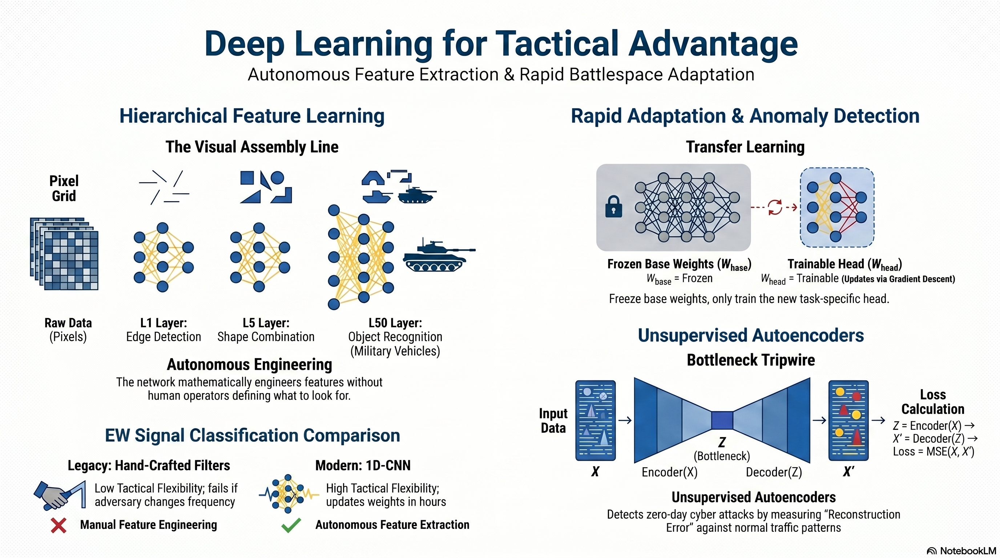

# L30: Deep Learning

In the previous lessons, we built shallow neural networks (one or two hidden layers), ran forward propagation by hand, and trained them with backpropagation and gradient descent. Those networks worked well on small, structured, tabular problems: a few columns of sensor readings, a handful of server metrics.

The data that matters most today does not look like that. A single drone video frame is millions of pixel values. A minute of network traffic is gigabytes of packets. A radio receiver produces millions of raw signal samples per second. Nobody can hand-design the right columns for that data, and a shallow network fed the raw numbers directly usually fails.

:::{admonition} Lesson Objectives
:class: note

* Explain hierarchical feature learning
* Describe modern deep architectures
* Apply transfer learning to adapt pre-trained models to domain-specific tasks
:::

**Deep learning** is the use of neural networks with many layers to learn useful representations directly from raw data. By stacking dozens (or hundreds) of layers, a network stops being a single decision rule and becomes a **hierarchical feature extractor**: each layer transforms the output of the layer before it into something slightly more abstract and more useful. In this lesson we cover what makes a network "deep," why depth was hard to train until recently, the main deep architectures in use today, how to adapt huge pre-trained models to a new task with transfer learning, how deep networks can detect never-before-seen anomalies, and where deep learning fails. [Ch. 10, {cite:t}`James2023`]

:::{admonition} Applications
:class: tip
- **Photo and Face Recognition** Your phone groups photos by person and unlocks when it sees your face. Both rely on deep convolutional networks that learned facial features from millions of images.

- **Cargo Logistics Classification** You need to deploy an AI on a surveillance drone to classify vehicles at a logistics hub as either "Military Transport" or "Civilian Cargo," but you only have a few hundred labeled images.

- **Cyber Intrusion Detection** You are defending a secure Air Force network. Attackers constantly change their tools and techniques, so a classifier trained only on *known* attacks will miss new ones. You need a model that learns what *normal* looks like and flags anything that does not fit.

- **Electronic Warfare Signal Classification** You need to identify adversary radar emitters from raw radio samples, and adapt quickly when the adversary changes their waveform.
:::

 

## What Makes Learning "Deep"?

### From Shallow to Deep

Recall the pieces from L28 and L29. A neuron computes a weighted sum and applies an activation. A layer is many neurons reading the same inputs. A network is layers feeding forward. Training is the loop of forward pass, loss, backpropagation, and gradient descent.

Deep learning uses exactly the same pieces. Nothing about the neuron or the training loop changes. What changes is the **depth** (the number of layers between input and output) and, in modern architectures, how the layers are **wired**.

| | Shallow network (L28) | Deep network (L30) |
|---|---|---|
| Hidden layers | 1 to 2 | Tens to hundreds |
| Typical input | Hand-chosen features (CPU load, payload weight) | Raw data (pixels, audio samples, text tokens, radio samples) |
| Who designs the features? | The human engineer | The network, layer by layer |
| Parameters | Tens to thousands | Millions to hundreds of billions |
| Training data needed | Hundreds to thousands of examples | Often millions (or a pre-trained model, see Transfer Learning) |

### Representation Learning

Every model we studied before neural networks depended on **features**: the columns a human decided to measure. Logistic regression on raw pixels does not work, because no single pixel tells you whether an image contains a truck. Someone first had to compute useful features ("number of wheels," "length-to-height ratio") and feed those in. This step, called **feature engineering**, was historically the most expensive and most fragile part of building a machine learning system.

Deep learning replaces hand-engineered features with **learned representations**. The hidden layers *are* the features. In L28 we saw two ReLU neurons invent "CPU too low" and "CPU too high" detectors. A deep network does the same thing at much larger scale: early layers invent simple features, and later layers combine them into complex ones. Because the features are learned by gradient descent, they are optimized for the task instead of guessed by a human.

### Why Depth, and Not Just Width?

In L28's backup material we saw that enough ReLU neurons in a *single* hidden layer can approximate almost any function. So why go deep?

* **Efficiency.** A shallow network can, in principle, represent a complex function, but it may need an astronomically large number of neurons to do it. A deep network can represent the same function far more compactly because it **reuses** intermediate results. An "edge" detector learned once in layer 1 is reused by every "shape" detector in layer 2, and every shape is reused by every object detector above it.

* **Composition matches the world.** Real data is built from parts: pixels form edges, edges form shapes, shapes form objects. Sounds form phonemes, phonemes form words, words form sentences. Deep networks mirror that structure, one layer per level of composition.

* **Empirically, it works.** On images, speech, and language, deeper networks (trained properly) have consistently outperformed shallow ones with the same number of parameters.

### Why Now? Three Ingredients

The core ideas behind neural networks date back to the 1950s through 1980s. Deep learning became dominant around 2012 because three ingredients finally arrived together:

1. **Data.** Large labeled datasets appeared. ImageNet, released in 2009, contained over a million labeled photographs across 1,000 categories.
2. **Compute.** Graphics processing units (GPUs), built for video games, turned out to be extremely fast at the matrix multiplications that make up a neural network layer.
3. **Algorithms.** A set of training improvements (ReLU activations, better weight initialization, dropout, normalization layers, and later residual connections and adaptive optimizers like Adam) made it possible to train deep networks reliably.

The turning point was the 2012 ImageNet competition. A deep convolutional network called **AlexNet** (Krizhevsky, Sutskever, and Hinton) achieved a top-5 error rate of about 15.3%, compared with about 26.2% for the next-best entry, which used traditional hand-engineered features. Within a few years nearly every competitive computer vision system was a deep network.

 

## Why Depth Was Hard: Vanishing Gradients

### The Whisper Down the Lane Problem

If depth is so useful, why did it take decades to work? The answer lies in backpropagation (L29). The gradient for an early-layer weight is a **product** of local derivatives along the path from that weight to the loss. Multiply enough numbers smaller than 1 together and the result shrinks toward zero.

Think of a message passed down a line of 20 people, each of whom repeats only a quarter of what they heard. By the end, essentially nothing is left. In a deep network with the wrong activation, the error signal reaching the first layers is so small that those layers barely learn at all, even though the last layers train fine. This is the **vanishing gradient problem**.

### The Math

The sigmoid activation from L28 has a derivative of at most 0.25 (at $z = 0$), and much smaller elsewhere. In the best case, a gradient passing backward through $n$ sigmoid layers is scaled by at most $0.25^n$.

> **Example 30.1 - The Vanishing Gradient**
> Suppose the gradient arriving at the output layer is 1.0, and each layer uses a sigmoid operating at its steepest point (derivative 0.25). Ignoring the weights, the gradient reaching the first layer of a 10-layer network is at most:
>
> $$0.25^{10} \approx 0.00000095$$
>
> With a learning rate of 0.01, the update to a first-layer weight is about $0.01 \times 0.00000095 \approx 10^{-8}$. The first layer is effectively frozen.
>
> Now replace the sigmoid with ReLU. For any neuron that is active (positive input), ReLU's derivative is exactly 1, so the activation itself does not shrink the gradient at all: $1^{10} = 1$.
>
> **Result:** Switching from sigmoid to ReLU in the hidden layers is one of the simplest reasons deep networks became trainable.

### The Fixes

Modern deep networks combine several techniques to keep gradients healthy:

* **ReLU activations** in hidden layers (derivative 1 when active), with sigmoid or softmax reserved for the output.
* **Careful weight initialization**, which starts each layer's outputs at a sensible scale so signals neither shrink nor explode as they pass forward and backward.
* **Normalization layers** (such as batch normalization), which rescale each layer's outputs during training to keep them in a well-behaved range.
* **Residual (skip) connections**, covered below, which give the gradient a direct shortcut back to early layers.

The opposite failure, **exploding gradients** (products of numbers larger than 1 growing without bound), produces the "loss becomes NaN" symptom from L29's training curves. The same fixes help, along with gradient clipping (capping the size of each update).

 

## Hierarchical Feature Learning

### The Visual Assembly Line

If you ask a human to identify a tank in a satellite image, they do not look at individual pixels; they look for a turret, treads, and a chassis. But a computer only sees a grid of numbers representing brightness values. How does it bridge the gap?

A deep neural network works like an automated assembly line, breaking the problem into a hierarchy of increasing complexity. A shallow network tries to jump straight from "pixels" to "tank," which usually fails. In a deep network, each layer builds on what the previous layer discovered. The network engineers its own features without a human ever telling it *what* to look for.

### Layered Extraction

If we feed the raw pixels of an image into a deep network trained to recognize objects:

* **Early layers (low-level):** Detect generic structures such as edges at various angles, lines, color contrasts, and simple textures. These are almost identical across networks trained on very different image datasets.
* **Middle layers (mid-level):** Combine edges into corners, circles, grids, and repeated textures, then into parts: wheels, windows, panels, metallic surfaces.
* **Late layers (high-level):** Combine parts into whole objects and object categories: "truck," "aircraft," "tank."

This hierarchy is not just a convenient story. Researchers have visualized what individual neurons in trained networks respond to (for example, Zeiler and Fergus, 2014) and found exactly this progression: early neurons fire on edges and color blobs, middle neurons on textures and parts, and late neurons on faces, wheels, and entire objects.

The same idea applies beyond images:

| Data | Early layers learn | Middle layers learn | Late layers learn |
|---|---|---|---|
| Images | Edges, colors | Textures, parts | Objects |
| Speech audio | Frequency bands | Phonemes | Words |
| Text | Character and word patterns | Phrases, grammar | Meaning, intent |
| Radio signals | Noise filtering, carrier patterns | Pulse shapes, modulation | Specific emitter type |

:::{admonition} Key Insight
:class: important
The early layers learn **general** features that are useful for almost any task on that kind of data. The later layers learn **specific** features tied to the original training task. This single observation is what makes transfer learning possible.
:::

 

## Modern Deep Architectures

A fully connected network (every neuron connected to every neuron in the next layer, as in L28) is called a **multilayer perceptron (MLP)**. MLPs work well for tabular data, but they scale badly to raw images, audio, or text. Modern deep learning relies on architectures whose wiring is designed around the structure of the data.

### Convolutional Neural Networks (CNNs)

#### The Problem with Fully Connected Layers on Images

A modest color image of 224 × 224 pixels has $224 \times 224 \times 3 = 150{,}528$ input values. Connecting all of them to a single hidden layer of just 1,000 neurons requires over 150 million weights, for one layer. That is expensive, slow, and a recipe for overfitting (L29). Worse, a fully connected layer has no idea that neighboring pixels are related, or that a wheel in the top-left corner is the same thing as a wheel in the bottom-right corner.

#### The Convolution Idea

A **convolutional neural network (CNN)** fixes both problems with two ideas:

* **Local receptive fields.** Each neuron looks only at a small patch of the input (for example, 3 × 3 pixels), because useful low-level features like edges are local.
* **Weight sharing.** The same small set of weights, called a **filter** or **kernel**, slides across the entire image. A filter that detects a vertical edge in one spot detects it everywhere. The output of sliding one filter across the image is called a **feature map**.

A convolutional layer learns many filters at once (for example, 64), each detecting a different pattern, producing 64 feature maps. **Pooling** layers then shrink the feature maps (for example, keeping the maximum value in each 2 × 2 block), which reduces computation and makes the network tolerant of small shifts in position. Stacking convolution and pooling layers produces exactly the edge → texture → part → object hierarchy described above.

> **Example 30.2 - Convolution by Hand**
> A small grayscale image patch is dark on the left (0) and bright on the right (10), so there is a vertical edge in the middle:
>
> $$\text{Input} = \begin{bmatrix} 0 & 0 & 0 & 10 & 10 & 10 \\ 0 & 0 & 0 & 10 & 10 & 10 \\ 0 & 0 & 0 & 10 & 10 & 10 \end{bmatrix} \qquad \text{Filter} = \begin{bmatrix} -1 & 0 & 1 \\ -1 & 0 & 1 \\ -1 & 0 & 1 \end{bmatrix}$$
>
> Slide the 3 × 3 filter across the input one column at a time. At each position, multiply each filter weight by the pixel beneath it and add the nine products (a weighted sum, exactly like a neuron).
>
> * Columns 1 to 3 (all dark): $3 \times (-1 \cdot 0 + 0 \cdot 0 + 1 \cdot 0) = 0$
> * Columns 2 to 4: $3 \times (-1 \cdot 0 + 0 \cdot 0 + 1 \cdot 10) = 30$
> * Columns 3 to 5: $3 \times (-1 \cdot 0 + 0 \cdot 10 + 1 \cdot 10) = 30$
> * Columns 4 to 6 (all bright): $3 \times (-1 \cdot 10 + 0 \cdot 10 + 1 \cdot 10) = 0$
>
> $$\text{Feature map} = \begin{bmatrix} 0 & 30 & 30 & 0 \end{bmatrix}$$
>
> **Result:** The filter outputs zero over flat regions and a large value exactly where brightness changes from left to right. It is a vertical-edge detector. In a CNN, nobody writes this filter by hand; gradient descent discovers filters like it because they reduce the loss.

> **Example 30.3 - Why Weight Sharing Matters**
> Compare two first layers for a 224 × 224 × 3 color image:
>
> * **Fully connected** to 1,000 neurons: $150{,}528 \times 1{,}000 = 150{,}528{,}000$ weights, plus 1,000 biases.
> * **Convolutional** with 64 filters of size 3 × 3 × 3: each filter has $3 \times 3 \times 3 = 27$ weights, so $64 \times 27 = 1{,}728$ weights, plus 64 biases, for **1,792** parameters.
>
> **Result:** The convolutional layer uses roughly 84,000 times fewer parameters, and because every filter is applied everywhere, it automatically recognizes a feature regardless of where it appears in the image.

CNNs are not limited to images. A **1D convolutional network** slides filters along a single dimension (time), which makes it well suited to audio, sensor telemetry, and raw radio signals (see the Electronic Warfare case study below).

### Residual Networks (ResNets)

Even with ReLU, very deep plain networks were hard to train: adding layers sometimes made training accuracy *worse*. In 2015, He et al. introduced **residual connections**. Instead of forcing a block of layers to learn an entire transformation $H(x)$, the block learns only the *change* $F(x)$ and adds the input back:

$$\text{output} = F(x) + x$$

This "skip connection" gives the gradient a direct path backward around each block, so it does not vanish even across 100 or more layers. If a block has nothing useful to add, it can simply learn $F(x) \approx 0$ and pass its input through unchanged. Residual connections made networks with 50, 101, and 152 layers trainable, and some form of skip connection appears in nearly every modern deep architecture, including transformers.

### Recurrent Networks (RNNs and LSTMs)

Text, speech, and time series are **sequences**, where order matters. A **recurrent neural network (RNN)** processes a sequence one element at a time while carrying a hidden "memory" vector forward from step to step. Plain RNNs suffer badly from vanishing gradients over long sequences; **long short-term memory (LSTM)** networks add gating mechanisms that decide what to remember and what to forget. RNNs and LSTMs dominated speech recognition and machine translation in the 2010s but have largely been replaced by transformers for most large-scale tasks.

### Transformers and Attention

A **transformer** (Vaswani et al., 2017) processes all elements of a sequence at once using a mechanism called **attention**. For each element (for example, each word), attention computes how relevant every other element is and builds a new representation as a weighted combination of them. In the sentence "The pilot landed the aircraft because *it* was low on fuel," attention lets the network learn that "it" should draw most heavily on "aircraft."

Because transformers process sequences in parallel rather than one step at a time, they train efficiently on enormous datasets. They are the architecture behind **large language models** (the chat assistants many of you use daily), and they are now also used for images, audio, and code. When you used AI tools earlier in this course, you were using a very deep transformer.

### Architecture Summary

| Architecture | Built for | Key idea | Example uses |
|---|---|---|---|
| MLP (L28) | Tabular data | Every neuron connects to every neuron | Risk scores, simple sensor models |
| CNN (2D) | Images, video, maps | Small shared filters slide across the input | Face unlock, medical imaging, satellite imagery |
| CNN (1D) | Signals, time series | Filters slide along time | Audio, telemetry, radio signals |
| ResNet | Very deep CNNs | Skip connections: output $= F(x) + x$ | Backbone for most image models |
| RNN / LSTM | Sequences | Hidden memory carried step to step | Older speech and translation systems |
| Transformer | Sequences (and more) | Attention: every element weighs every other | Large language models, translation, code |
| Autoencoder | Unlabeled data | Compress to a bottleneck, then reconstruct | Anomaly detection, denoising |

 

## Transfer Learning

Training a deep image classifier from scratch requires a very large labeled dataset (often millions of images), substantial GPU time, and expertise in tuning. Most real projects, including the drone cargo classifier, have a few hundred or a few thousand labeled examples and a laptop or a single GPU. Training a deep network from scratch on so little data would overfit badly (L29).

### Basic Training vs. Specialized Schools

Think about how the Air Force trains personnel. A Special Tactics pipeline does not start by teaching recruits to march or wear the uniform; they learned those universal foundations in Basic Training. The specialized school *transfers* that foundation and teaches only the mission-specific skills. The same is true of a software engineer who already knows Python picking up a new web framework: they reuse what they know and learn only what is new.

We do the same thing with neural networks. We take a large, publicly available network that has already been trained on millions of everyday images. Its early and middle layers have already learned excellent general-purpose edge, texture, and shape detectors (the Key Insight above). We keep that knowledge and retrain only the part of the network that is specific to our new task.

### The Transfer Protocol

Instead of starting with random weights, we use {term}`Transfer Learning`:

1. **Start with a pre-trained base.** Load a network such as ResNet-50 or MobileNet with weights learned on a large dataset like ImageNet.
2. **Remove the original head.** The final layer (the "head") was built to output the original 1,000 categories. Slice it off.
3. **Attach a new head.** Add a new, randomly initialized output layer sized for our task (for example, 2 classes: "Military Transport" and "Civilian Cargo").
4. **Freeze the base.** Mark the base layers as non-trainable so gradient descent cannot overwrite their hard-earned features with noise from our small dataset.
5. **Train the head.** Run the normal training loop (L29). Only the head's weights change.

$$W_{base} = \text{Frozen (No Gradient Updates)}$$

$$W_{head} = \text{Trainable (Updates via Gradient Descent)}$$

Why freeze? At the start of training, the new head is random, so the gradients flowing back from it are large and essentially noise. If the base were trainable at that moment, those noisy gradients would scramble its carefully learned features. Freezing protects the base while the head learns to use it.

> **Example 30.4 - How Much Are We Actually Training?**
> ResNet-50 has about 25.6 million parameters. Its final pooled feature vector has 2,048 values, and its original head maps those to 1,000 ImageNet classes ($2{,}048 \times 1{,}000 + 1{,}000 = 2{,}049{,}000$ parameters). Removing that head leaves a base of roughly 23.5 million parameters.
>
> Our new 2-class head needs $2{,}048 \times 2 + 2 = 4{,}098$ parameters.
>
> $$\frac{4{,}098}{23{,}500{,}000 + 4{,}098} \approx 0.017\%$$
>
> **Result:** We train fewer than 0.02% of the network's parameters. With so few trainable weights, a few hundred labeled images are enough to fit the head without severe overfitting, and training takes minutes instead of weeks. (Each training step still runs a forward pass through the frozen base, so the time saving comes mostly from needing far less data and far fewer epochs.)

### Feature Extraction vs. Fine-Tuning

There are two common ways to use a pre-trained network:

* **Feature extraction:** Freeze the entire base and train only the new head (the protocol above). Fast, safe, and the right first step with small datasets.
* **Fine-tuning:** After the head has been trained, unfreeze some of the *later* base layers and continue training the whole thing with a **much smaller learning rate** (for example, 10 to 100 times smaller). This lets the high-level features adjust to the new domain without destroying the general low-level features. Fine-tuning usually improves accuracy when you have more data or when the new images look quite different from the original training images.

Which approach to choose depends on how much labeled data you have and how similar your data is to the original training data:

| | New data **similar** to original (e.g., everyday photos) | New data **different** from original (e.g., thermal or radar imagery) |
|---|---|---|
| **Small dataset** | Feature extraction: freeze the base, train the head | Freeze the earliest layers only; train the head plus some later layers carefully |
| **Large dataset** | Fine-tune most or all layers with a small learning rate | Fine-tune extensively, or consider training from scratch |

:::{admonition} Caution: Domain Shift
:class: warning
Transfer learning works best when the new data resembles the original. A network pre-trained on everyday ground-level photographs has learned excellent edge and texture detectors, which transfer well to almost any image. But overhead satellite imagery, infrared video, or synthetic aperture radar look very different from ImageNet photos. In those domains, more layers usually need to be fine-tuned, and models pre-trained on similar imagery (when available) perform better. Always measure performance on a held-out test set drawn from the *deployment* conditions.
:::

### Foundation Models

The largest modern example of transfer learning is the **foundation model**: a very large network (often a transformer) pre-trained on enormous amounts of broad data, then adapted to many downstream tasks. Large language models are foundation models. Organizations adapt them to their own documents, terminology, or tasks by fine-tuning or by supplying task-specific examples, rather than training a language model from scratch. The principle is identical to the cargo classifier: reuse general knowledge, train only what is specific.

 

## Unsupervised Autoencoders

Every network so far has been **supervised**: each training example came with a label. But labels are expensive, and for some problems the most important cases (a brand-new cyber attack, a never-before-seen equipment failure) have no labeled examples at all. Autoencoders learn from *unlabeled* data.

### The Sketch Artist Tripwire

Imagine a sketch artist who has only ever drawn fighter jets. They know jet shapes so well that if you show them a photo of an F-22 for three seconds, they can redraw it from memory almost perfectly. But if you show them a submarine, their memory has no good way to store it. When they redraw it, the result is a distorted mess.

An **Autoencoder** is the mathematical equivalent of this artist. We force it to compress normal network traffic into a tiny mathematical bottleneck and then reconstruct (redraw) the traffic from that bottleneck. Because it trains *exclusively* on normal, benign traffic, it becomes an expert at drawing "fighter jets."

When traffic arrives that does not resemble anything in the training data (a new type of attack), it is a "submarine." The autoencoder tries to compress and reconstruct it and does a poor job. By measuring how bad the reconstruction is (the reconstruction error), we can flag suspicious activity without ever having seen that attack before.

### The Autoencoder

An {term}`Autoencoder` consists of an {term}`Encoder` that compresses the input down into a small bottleneck (the {term}`Latent Space (Bottleneck)`, $Z$), and a {term}`Decoder` that attempts to reconstruct the original input ($X'$) from that bottleneck.

$$Z = \text{Encoder}(X)$$

$$X' = \text{Decoder}(Z)$$

$$\text{Loss} = \text{MSE}(X, X')$$

The "label" for each example is the example itself, so no human labeling is required. (This is why autoencoders are sometimes called *self-supervised*.) The training loop is exactly L29's: forward pass, MSE loss between input and reconstruction, backpropagation, gradient descent.

The bottleneck is the key. Because $Z$ is much smaller than $X$, the network cannot simply copy its input. It must learn the most important structure of normal data, the patterns that let it rebuild an input from a compact summary. Anything that does not follow those patterns cannot be summarized well and reconstructs poorly.

### Detection with Reconstruction Error

After training on normal data, we use the {term}`Reconstruction Error` as an anomaly score:

1. Pass each new input through the autoencoder.
2. Compute the reconstruction error, $\text{MSE}(X, X')$.
3. If the error exceeds a **threshold**, raise an alert.

> **Example 30.5 - The Reconstruction Error Tripwire**
> An autoencoder is trained on normal network sessions, each summarized by 4 scaled features (for example, bytes sent, session duration, ports contacted, failed logins).
>
> **A normal session:** $X = [0.2, 0.5, 0.1, 0.8]$, reconstructed as $X' = [0.25, 0.45, 0.1, 0.8]$.
>
> $$\text{MSE} = \frac{(0.05)^2 + (0.05)^2 + 0^2 + 0^2}{4} = \frac{0.005}{4} = 0.00125$$
>
> **An unusual session:** $X = [0.9, 0.1, 0.7, 0.2]$, reconstructed as $X' = [0.4, 0.4, 0.3, 0.6]$.
>
> $$\text{MSE} = \frac{(0.5)^2 + (0.3)^2 + (0.4)^2 + (0.4)^2}{4} = \frac{0.25 + 0.09 + 0.16 + 0.16}{4} = 0.165$$
>
> The team set the alert threshold at 0.01, which is the 99th percentile of reconstruction errors on a held-out set of normal sessions.
>
> **Result:** The normal session (0.00125) passes. The unusual session (0.165, more than 130 times larger) trips the alert and is routed to an analyst.

### Choosing the Threshold

The threshold is a precision-recall trade-off, exactly like the classification threshold in L26:

* **Lower threshold:** catches more real attacks (higher recall) but flags more unusual-but-harmless activity (lower precision). Analysts drown in false alarms.
* **Higher threshold:** fewer false alarms (higher precision) but more missed attacks (lower recall).

A common starting point is a high percentile (such as the 99th) of reconstruction errors on held-out *normal* data, then adjusting based on the cost of each type of error and the analysts' capacity.

### Limitations

Autoencoders are powerful, but they are not magic:

* **"Unusual" is not the same as "malicious."** A new software update, a backup job, or a user working at an odd hour can produce high reconstruction error. Every alert needs triage.
* **Attacks that look normal slip through.** An adversary who carefully mimics normal traffic patterns (for example, slow, low-volume data exfiltration) may reconstruct well and never trip the alarm.
* **Normal changes over time.** As the network, its users, and its software change, "normal" drifts, and the autoencoder must be retrained periodically.
* **The training data must be clean.** If attack traffic is accidentally included in the "normal" training set, the autoencoder learns to reconstruct it well and stops flagging it.

In practice, autoencoder-based anomaly detection is one layer of a defense-in-depth approach, used alongside supervised classifiers and signature-based rules that catch *known* attacks reliably.

To see how the reconstruction-error tripwire behaves during a zero-day attack, interact with the Autoencoder simulation below.

 

## Limitations and Risks of Deep Learning

Deep learning's capabilities come with serious costs and failure modes. Understanding them is essential for anyone who will build, buy, or depend on these systems.

### Data and Compute Hunger

Training large models from scratch requires vast labeled datasets and significant computing infrastructure and energy. Transfer learning reduces this burden but does not eliminate it, and a model can only be as good as the data it learned from.

### Interpretability

A logistic regression model has a handful of weights you can read. A deep network has millions of interacting weights, and it is very difficult to explain *why* it produced a specific output. This "black box" problem matters when decisions must be justified, audited, or trusted, as in medicine, law enforcement, finance, and military targeting. Tools exist to highlight which parts of an input most influenced a prediction, but they provide partial explanations, not guarantees.

### Shortcut Learning

Deep networks find whatever pattern most easily reduces the loss, and that pattern is not always the one we intended. A classic example: a model trained to distinguish two classes of images learned to rely on the *background* (snow versus grass) rather than the object itself, because the backgrounds happened to differ between classes in the training data. It scored well on test images with the same bias and failed in the real world. Careful dataset design and testing under realistic conditions are the main defenses.

### Distribution Shift

Deep networks perform best on data that resembles their training data. A vehicle classifier trained on daytime summer imagery may degrade badly at night, in snow, or in a new region. This is the same generalization problem from L26, made more dangerous because deep models can be confidently wrong.

### Adversarial Examples

Deep networks can be fooled by carefully crafted inputs. Goodfellow, Shlens, and Szegedy (2015) showed that adding a tiny, nearly invisible pattern of noise to an image of a panda caused a network to classify it as a gibbon with 99.3% confidence. Later work showed physical versions: printed patches or stickers that cause object detectors to miss or misidentify objects. For cyber defense and military systems that face intelligent adversaries, this is not a theoretical concern. An adversary who understands the model can deliberately craft inputs to evade it, and an adversary who can influence the training data can **poison** it.

:::{admonition} Key Takeaway
:class: important
Deep learning shifts work from hand-engineering features to curating data, choosing architectures, and testing rigorously. It does not remove the need for human judgment. The more consequential the decision, the more important it is to test under realistic and adversarial conditions and to keep a human accountable for the outcome.
:::

 

## Electronic Warfare (Case Study)

**The Historical Paradigm:** For decades, classifying radar and radio frequency (RF) signals in Electronic Warfare relied on hand-crafted signal processing. Signals Intelligence (SIGINT) analysts would capture a signal, run a Fast Fourier Transform (FFT) to convert it from the time domain to the frequency domain, and manually engineer features such as pulse width, pulse repetition interval, frequency modulation, and amplitude. These features were then fed into a conventional classifier, such as a Support Vector Machine. If an adversary changed their radar's waveform, the hand-tuned features and rules could fail, and engineers had to redesign them.

**The Deep Learning Paradigm:**
Modern research and an increasing number of fielded systems feed raw **In-Phase and Quadrature (IQ)** radio samples directly into deep networks, most commonly {term}`1D-Convolutional Neural Network (1D-CNN)`s. Public research datasets such as RadioML (O'Shea and colleagues) helped demonstrate that deep networks trained on raw IQ samples can classify modulation types more accurately than traditional hand-crafted feature pipelines, especially in noisy conditions.

Because these networks are deep, they learn the hierarchical features of the RF spectrum autonomously, just as image networks learn edges. The early layers learn filter-like patterns that separate signal from noise, the middle layers learn pulse and modulation structures, and the final layers distinguish specific emitter types.

When an adversary changes tactics, the goal is that the team collects a new batch of labeled IQ data, runs a transfer learning update (retraining the head, and perhaps fine-tuning the later layers), validates the result, and pushes updated weights to fielded systems far faster than hand-redesigned processing would allow. Deep learning shifts EW toward **software-defined**, rapidly updatable capability.

**The caveats from this lesson still apply.** Deep EW classifiers need large amounts of carefully labeled signal data; they can be degraded by signals unlike their training data (new environments, new hardware, deliberate deception); they are potential targets for adversarial manipulation; and they must run within the size, weight, and power limits of an aircraft pod or ground system. In practice, many systems combine learned features with traditional signal processing rather than abandoning domain expertise entirely.

 

## Summary

* **Deep learning** uses many-layered neural networks to learn representations directly from raw data, replacing hand-engineered features with learned ones.
* **Depth** lets networks build features hierarchically (edges → parts → objects) and represent complex functions far more efficiently than a single wide layer.
* Deep networks became practical around 2012 thanks to **large datasets, GPUs, and training improvements** (ReLU, better initialization, normalization, dropout, residual connections, Adam).
* **Vanishing gradients** made deep networks hard to train; ReLU and residual connections give gradients a healthy path back to early layers.
* **Architectures** are matched to data structure: CNNs for images and signals (local, shared filters), RNNs/LSTMs and transformers for sequences, autoencoders for unlabeled data.
* **Transfer learning** reuses a pre-trained network's general early-layer features: freeze the base, replace and train the head, and optionally fine-tune later layers with a small learning rate.
* **Autoencoders** learn to reconstruct normal data; high reconstruction error flags anomalies, with a threshold that trades precision against recall.
* Deep learning has real **limitations**: data and compute hunger, poor interpretability, shortcut learning, distribution shift, and vulnerability to adversarial examples.

## Summary Infographic

 

## Knowledge Check & Practice Questions

1. During a rapid deployment, you use {term}`Transfer Learning` to adapt a massive visual model to classify local adversary vehicles. Why do you mathematically "freeze" the first 40 layers of the network, and what specific types of features are those early layers actually detecting?

2. When building an {term}`Autoencoder` to defend an Air Force network, a junior engineer suggests training the model on a dataset containing *both* normal traffic and historical malware signatures. Explain why this approach defeats the entire purpose of the Autoencoder's "tripwire" design for detecting Zero-Day attacks.

3. In the historical Electronic Warfare paradigm, Signal Intelligence operators had to manually engineer features (like pulse width and amplitude) using Fast Fourier Transforms before classifying a radar signal. How does upgrading to a deep {term}`1D-Convolutional Neural Network (1D-CNN)` fundamentally change this workflow, and why does it make the electronic attack pod more agile?

4. A 12-layer network uses sigmoid activations in every hidden layer, and its first few layers barely change during training while the last layers learn normally. Name the problem, explain why it happens using the chain rule from L29, and describe two architectural changes that would help.

5. A 3 × 3 filter with weights $\begin{bmatrix} -1 & -1 & -1 \\ 0 & 0 & 0 \\ 1 & 1 & 1 \end{bmatrix}$ slides over an image. What kind of feature does it detect? What would its output be over a region where every pixel has the same value?

6. Explain why a convolutional layer needs far fewer parameters than a fully connected layer on the same image, and why that matters for overfitting.

7. You have 300 labeled infrared images of vehicles and access to a network pre-trained on everyday color photographs. Would you freeze the entire base or fine-tune some layers? Justify your choice using dataset size and domain similarity.

8. An autoencoder-based intrusion detector produces too many false alarms for the analysts to keep up with. What single setting would you change first, and what is the cost of changing it?

9. Give two reasons a deep network that achieved 98% test accuracy in development might perform poorly after deployment.
