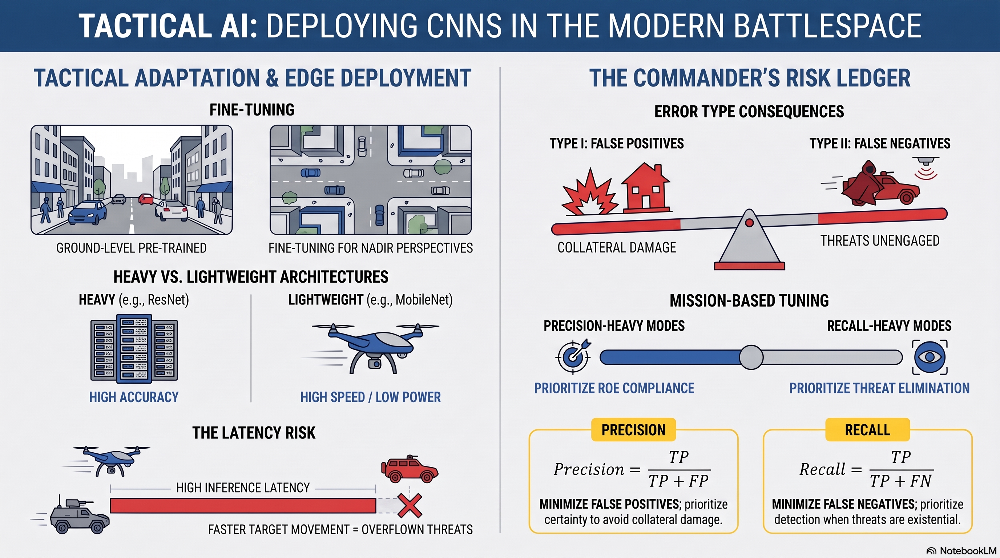

# ☑️ L32: CNN Applications

In the previous lessons, we learned the mechanics of how Convolutional Neural Networks (CNNs) use sliding filters and pooling layers to understand spatial relationships (L31), and how to reuse a pre-trained network through transfer learning (L30). Now we turn those mechanics into a working system. A CNN that scores well in a notebook is not yet useful. It has to be adapted to the imagery it will actually see, evaluated in terms of the mistakes that matter to the people relying on it, and made fast and small enough to run on the hardware where it will be deployed.

:::{admonition} Lesson Objectives
:class: note

* Fine-tune a pre-trained CNN on spatial data
* Evaluate model outputs using confusion matrices to quantify operational risks
* Analyze architectural trade-offs between speed and accuracy for edge deployment
:::

:::{admonition} Applications
:class: tip
- **Land-Use Mapping:** An agency classifies satellite image tiles as farmland, forest, highway, river, or residential to track urban growth, crop health, and flood damage.

- **Wildfire Watch:** Cameras on mountaintop towers run a CNN locally to spot smoke within minutes, with no reliable internet connection.

- **Overhead Vehicle Recognition:** An analyst team uses a CNN to screen thousands of overhead images for vehicles of interest, so humans review only the tiles most likely to matter.

- **Drone Payload:** A small uncrewed aircraft must classify what its camera sees onboard, within strict limits on power, weight, and processing time.
:::

<br>
<hr width="100%" size="4" color="black">

## From Notebook to Mission: The Deployment Pipeline

Every applied CNN project moves through the same stages. This lesson covers the middle three.

| Stage | Question it answers | Covered in |
|---|---|---|
| 1. Collect and label data | What examples represent the real task? | L26, L29 |
| 2. **Adapt a pre-trained model** | How do we specialize general features to our imagery? | This lesson |
| 3. **Evaluate against mission risk** | Which mistakes does it make, and what do they cost? | This lesson |
| 4. **Optimize for the hardware** | Will it run fast enough, within power and memory limits? | This lesson |
| 5. Deploy and monitor | Is it still accurate as conditions change? | L30 (distribution shift) |

The stages are not independent. A model that is accurate but too slow forces you back to stage 2 to pick a smaller architecture; an evaluation that reveals dangerous blind spots forces you back to stage 1 for better data.

<br>
<hr width="100%" size="4" color="black">

## Fine-Tuning for Spatial Data

### Specializing the Satellite Scout

In Lesson 30, we explored basic {term}`Transfer Learning`: we froze a large pre-trained network's base layers and trained only a new {term}`Classification Head`. That works well when the new images look similar to the images the network was originally trained on.

However, standard pre-trained models (like ResNet or MobileNet) were trained on datasets like ImageNet, which consists of ground-level photographs taken by people looking horizontally at cars, buildings, animals, and trees. Satellite and drone imagery, such as the EuroSAT or xView datasets, presents a very different view: a **top-down (nadir) perspective**.

To bridge this gap, we use {term}`Fine-Tuning`. Instead of keeping the entire base network frozen, we "unfreeze" the last few convolutional layers and let them adjust.

Think of an expert reconnaissance scout who spent years tracking targets on foot and is reassigned to a high-altitude surveillance aircraft. Their fundamental pattern-recognition skills still work, but they need to adjust their mental model to how the same targets look from far overhead. By allowing the upper convolutional layers to update their weights slightly, the network adapts its learned features to the angles, scales, and shadows of overhead imagery, while the early layers keep their general-purpose edge and texture detectors.

### Why Overhead Imagery Is a Different Domain

Recall from L30 that early CNN layers learn **general** features (edges, color contrasts, textures) and later layers learn **specific** ones. Overhead imagery keeps the general features useful but breaks many of the specific ones:

* **Perspective.** A car seen from the side has wheels, windows, and a profile. From directly above it is a small rounded rectangle. High-level "car" features learned from ground photos simply do not appear.
* **Scale and resolution.** Overhead imagery is described by its **ground sample distance (GSD)**: the width of ground covered by one pixel. At 0.3 m GSD, a 4.5 m car spans about 15 pixels; at 10 m GSD, an entire city block may be a handful of pixels. Objects are often far smaller in the frame than anything in ImageNet.
* **Orientation.** Ground photos have a natural "up" (sky on top). Overhead images do not: a runway or a vehicle can appear at any rotation.
* **Spectral bands.** Many satellites record more than red, green, and blue, such as near-infrared, which is excellent for distinguishing vegetation. A network pre-trained on 3-channel photos needs adjustment to use extra bands.
* **Context and clutter.** Shadows, clouds, seasonal changes, and look angle vary across collections and can change appearance more than the object itself.
* **Class imbalance.** Most tiles contain nothing of interest. The objects that matter may appear in far fewer than 1% of tiles (see the base-rate trap below).

Because of these differences, freezing the entire base often leaves accuracy on the table. Fine-tuning lets the later layers relearn what objects look like from above.

### Two Benchmark Datasets

| Dataset | Source | Contents | Typical use |
|---|---|---|---|
| **EuroSAT** (Helber et al., 2019) | Sentinel-2 satellite, about 10 m GSD | 27,000 labeled 64 × 64 patches, 10 land-use classes (forest, highway, river, residential, and others), 13 spectral bands | Scene classification: what is this tile? |
| **xView** (Lam et al., 2018) | WorldView-3 satellite, about 0.3 m GSD | Over 1 million labeled objects in 60 classes, from vehicles to buildings | Object detection: what objects are where? |

EuroSAT is a common first fine-tuning exercise because its small, labeled tiles train quickly. xView is closer to operational analysis, with tiny objects in large scenes.

### The Two-Stage Fine-Tuning Recipe

Fine-tuning is usually done in two stages. Skipping stage 1 is the most common mistake.

1. **Load a pre-trained base** without its original head, and add a new head sized for your classes.
2. **Stage 1: Train the head only.** Freeze the entire base and train the new head until validation loss levels off. At the start, the new head's weights are random, so its gradients are large and noisy; freezing the base protects its learned features from that noise.
3. **Stage 2: Unfreeze the top of the base.** Make the last few blocks trainable, keep the earlier blocks frozen, and continue training with a **much smaller learning rate**, typically 10 to 100 times smaller than in stage 1. A large learning rate here would quickly overwrite the pre-trained features, a failure sometimes called *catastrophic forgetting*.
4. **Monitor validation loss and stop early** (L29). Fine-tuning adds trainable parameters, which raises the risk of overfitting a small dataset.

How much to unfreeze depends on how much labeled data you have and how different your images are (the decision table from L30): with a few hundred images, unfreeze little or nothing; with tens of thousands of images that look very different from ImageNet, unfreeze more.

:::{admonition} Implementation Note: Batch Normalization
:class: warning
Most modern CNNs contain {term}`Batch Normalization` layers, which keep running statistics of the data they have seen. When fine-tuning a small dataset, keep these layers in inference mode (in Keras, call the base model with `training=False`). Otherwise the running statistics are overwritten by your small batches and accuracy can collapse.
:::

### What This Looks Like in Code

The following Keras sketch fine-tunes MobileNetV2 for the 10 EuroSAT classes. The two-stage structure mirrors the recipe above.

```python
import tensorflow as tf

IMG = (224, 224, 3)   # EuroSAT tiles (64 x 64) are resized to the base's expected input
base = tf.keras.applications.MobileNetV2(input_shape=IMG, include_top=False, weights="imagenet")
base.trainable = False                      # Stage 1: freeze the entire base

inputs = tf.keras.Input(shape=IMG)
x = tf.keras.applications.mobilenet_v2.preprocess_input(inputs)
x = base(x, training=False)                 # keep batch norm in inference mode
x = tf.keras.layers.GlobalAveragePooling2D()(x)
x = tf.keras.layers.Dropout(0.2)(x)
outputs = tf.keras.layers.Dense(10, activation="softmax")(x)
model = tf.keras.Model(inputs, outputs)

model.compile(optimizer=tf.keras.optimizers.Adam(1e-3),
              loss="sparse_categorical_crossentropy", metrics=["accuracy"])
model.fit(train_ds, validation_data=val_ds, epochs=10)

# Stage 2: unfreeze only the top of the base and use a much smaller learning rate
base.trainable = True
for layer in base.layers[:-30]:             # everything except the last 30 layers stays frozen
    layer.trainable = False
model.compile(optimizer=tf.keras.optimizers.Adam(1e-5),   # 100x smaller
              loss="sparse_categorical_crossentropy", metrics=["accuracy"])
model.fit(train_ds, validation_data=val_ds, epochs=10,
          callbacks=[tf.keras.callbacks.EarlyStopping(patience=3, restore_best_weights=True)])
```

Two details matter: the model must be **recompiled** after changing which layers are trainable, and the learning rate drops sharply between stages.

> **Example 32.1 - How Much Are We Training?**
> MobileNetV2 without its original head has about 2.26 million parameters and outputs a 1,280-value feature vector for each image. Our new 10-class head has:
>
> $$1{,}280 \times 10 + 10 = 12{,}810 \text{ parameters}$$
>
> **Stage 1:** Only the head trains: $12{,}810 / 2{,}270{,}794 \approx 0.56\%$ of the network.
>
> **Stage 2:** Suppose we also unfreeze MobileNetV2's final 1 × 1 convolution, which maps 320 channels to 1,280. That layer alone has $320 \times 1{,}280 = 409{,}600$ weights, so trainable parameters jump to roughly 420,000, about 18% of the network.
>
> **Result:** Unfreezing even one late layer multiplies the trainable parameters by more than 30. That is why stage 2 uses a tiny learning rate and early stopping: far more weights can now move, and our dataset has not grown.

### Data Augmentation for Overhead Imagery

**Data augmentation** creates extra training examples by applying label-preserving transformations to existing images. It is one of the most effective ways to reduce overfitting (L29) when labeled data is limited.

The right augmentations depend on the domain. For ground-level photos, a horizontal flip is safe but an upside-down car is unrealistic. For overhead imagery, there is no natural "up," so **all rotations by 90 degrees and all flips** are valid. Each image yields 8 orientation variants (4 rotations, each with or without a flip), which also teaches the network that a vehicle is a vehicle regardless of heading. Brightness and contrast changes can simulate different lighting and sensors.

### Don't Leak Geography Into Your Test Set

Spatial data has a trap that ordinary photo datasets do not: **spatial autocorrelation**. Neighboring tiles look alike. If tiles are split into training and test sets at random, the test set ends up full of near-duplicates of training tiles (the next field over, the same road a few hundred meters on), and test accuracy looks far better than it will be on a new region.

The fix is to **split by geography**: hold out entire regions, cities, or collection dates for testing (Roberts et al., 2017, discuss this issue for spatial data). A model that will be deployed over unfamiliar terrain should be tested on unfamiliar terrain. This is the L26 generalization principle applied to maps.

<br>
<hr width="100%" size="4" color="black">

## Confusion Matrices & Operational Risk

### The Commander's Risk Ledger

In a computer science lab, an error is just a point deducted from an accuracy score. In operations, different types of errors have radically different consequences. We map these errors using a {term}`Confusion Matrix`.

Imagine a recognition system that screens a sector for hostile surface-to-air missile (SAM) launchers and cues human analysts. The system can fail in two distinct ways:

1. **The {term}`False Positive (Type I Error)`:** The AI flags a civilian delivery truck as a hostile SAM launcher. Analysts waste time, and if humans over-trust the alert, the error could feed a decision that violates the Rules of Engagement (ROE) and causes serious strategic harm.
2. **The {term}`False Negative (Type II Error)`:** The AI labels an active SAM launcher as a civilian truck and ignores it. The threat goes unreported, putting friendly aircraft at risk.

By examining a confusion matrix, a commander can see exactly which way the AI is failing. If the model produces many false positives, the commander might raise the alert threshold or require stronger corroboration before acting. If it produces many false negatives, the commander might lower the threshold and assign more analysts to review alerts.

Note what the matrix does *not* change: the decision to use force remains a human responsibility. U.S. Department of Defense policy (DoD Directive 3000.09, *Autonomy in Weapon Systems*, updated 2023) requires that autonomous and semi-autonomous weapon systems be designed to allow commanders and operators to exercise appropriate levels of human judgment over the use of force. A confusion matrix is one of the tools that makes that judgment informed.

### Reading a Multiclass Confusion Matrix

Real applications usually have more than two classes. A multiclass confusion matrix has one row per **actual** class and one column per **predicted** class. The diagonal holds the correct predictions; every off-diagonal cell is a specific, named mistake.

* **Recall** for a class: the diagonal value divided by its **row** total. *Of all the real examples of this class, how many did we find?*
* **Precision** for a class: the diagonal value divided by its **column** total. *Of everything we labeled as this class, how much really was?*

> **Example 32.2 - Reading a Land-Use Confusion Matrix**
> A fine-tuned CNN classifies 400 held-out satellite tiles (100 per class) into four classes:
>
> | Actual \ Predicted | Forest | Highway | River | Residential | Row total |
> |---|---|---|---|---|---|
> | **Forest** | **95** | 0 | 3 | 2 | 100 |
> | **Highway** | 1 | **80** | 15 | 4 | 100 |
> | **River** | 2 | 12 | **84** | 2 | 100 |
> | **Residential** | 0 | 5 | 1 | **94** | 100 |
> | **Column total** | 98 | 97 | 103 | 102 | 400 |
>
> **Accuracy:** $(95 + 80 + 84 + 94) / 400 = 353 / 400 \approx 88.3\%$.
>
> **Per-class recall:** Forest $95/100 = 0.95$; Highway $80/100 = 0.80$; River $84/100 = 0.84$; Residential $94/100 = 0.94$.
>
> **Per-class precision:** Forest $95/98 \approx 0.97$; Highway $80/97 \approx 0.82$; River $84/103 \approx 0.82$; Residential $94/102 \approx 0.92$.
>
> **Interpretation:** The single accuracy number hides the real story. Nearly all errors are Highway and River being confused with each other (15 + 12 = 27 of the 47 mistakes). Both appear from above as long, thin, uniform strips, so the model has learned "linear feature" but not "which kind." The fix is targeted: more training examples of each, or extra spectral bands (water and pavement reflect near-infrared very differently).

### Precision vs. Recall in Mission Context

To tune a model to a commander's risk tolerance, we rely on two opposing metrics derived from the confusion matrix (L26):

$$\text{Precision} = \frac{\text{True Positives}}{\text{True Positives} + \text{False Positives}}$$

$$\text{Recall} = \frac{\text{True Positives}}{\text{True Positives} + \text{False Negatives}}$$

* **High Precision Mode:** Minimize false positives. Use this when the cost of a false alarm is unacceptable. The system flags a target only when it is highly confident, and accepts that it will miss some.
* **High Recall Mode:** Minimize false negatives. Use this when missing a real threat is the worst outcome. The system flags anything that resembles a threat and accepts more false alarms.

When both matter, the {term}`F1-Score` (the harmonic mean of precision and recall) summarizes them in one number. Its generalization, the **F-beta score**, lets you state how much more you care about recall: $F_\beta$ with $\beta = 2$ treats recall as twice as important as precision.

Most CNN classifiers output a probability, and a **decision threshold** turns that probability into a yes or no. Moving the threshold trades precision for recall along the {term}`Precision-Recall (PR) Curve`. Choosing the threshold is not a technical detail; it is where the mission's risk tolerance enters the system.

### Putting a Cost on Each Mistake

Precision and recall describe a model's errors. A **cost matrix** turns those errors into a decision by assigning a cost to each kind of mistake. The expected cost of a threshold is the number of each error type multiplied by its cost, summed.

> **Example 32.3 - Choosing a Threshold by Cost**
> A vehicle detector screens 1,000 test tiles, 100 of which actually contain a vehicle of interest. At two candidate thresholds:
>
> | Threshold | TP | FN | FP | TN | Precision | Recall |
> |---|---|---|---|---|---|---|
> | 0.5 | 85 | 15 | 40 | 860 | 0.68 | 0.85 |
> | 0.3 | 95 | 5 | 120 | 780 | 0.44 | 0.95 |
>
> The operations team estimates that a missed vehicle (FN) costs **20 units** (a follow-up collection and the risk of an unreported threat), while a false alarm (FP) costs **1 unit** (a few minutes of analyst review).
>
> * **Threshold 0.5:** $15 \times 20 + 40 \times 1 = 300 + 40 = 340$
> * **Threshold 0.3:** $5 \times 20 + 120 \times 1 = 100 + 120 = 220$
>
> **Result:** The lower threshold costs less, even though it triples the false alarms, because misses are so expensive.
>
> **What if misses cost only 5 units?** Threshold 0.5 costs $15 \times 5 + 40 = 115$; threshold 0.3 costs $5 \times 5 + 120 = 145$. Now the higher threshold wins. The break-even point is where $15c + 40 = 5c + 120$, or a miss cost of $c = 8$. The model did not change; the mission did.

### The Base-Rate Trap

Operational targets are usually rare. When positives are rare, even an excellent classifier can produce far more false alarms than real detections. This is the same base-rate effect we saw with Bayes' rule in L27.

> **Example 32.4 - When Rare Targets Meet Good Models**
> An area search covers 100,000 image tiles. About 1 in 1,000 tiles contains a target, so there are 100 real targets. The CNN has a recall of 0.95 and a false positive rate of just 1% on empty tiles.
>
> * True positives: $0.95 \times 100 = 95$
> * False positives: $0.01 \times 99{,}900 = 999$
> * Precision: $95 / (95 + 999) = 95 / 1{,}094 \approx 8.7\%$
>
> **Result:** More than 10 of every 11 alerts are false, even though the model is "99% accurate" on empty tiles. Analysts must review about 1,100 alerts to find 95 targets.
>
> **Mitigations:** Raise the threshold (trading away some recall); add a second-stage check, either a more expensive model or a human analyst, applied only to the flagged tiles; or focus the search on areas where targets are more likely, which raises the base rate.

The lesson for evaluation: always report the confusion matrix **at a realistic base rate**. A test set balanced 50/50 between targets and background will make precision look far better than it will be in the field.

### From the Matrix to the Mission

| If the confusion matrix shows... | Then consider... |
|---|---|
| Many false positives, and false alarms are costly | Raise the threshold; require corroboration from another sensor or analyst |
| Many false negatives, and misses are costly | Lower the threshold; add analysts to review the larger alert volume |
| Errors concentrated between two specific classes | Targeted data collection, extra spectral bands, or a specialized second-stage model |
| Good test results, but the test set has a different base rate or region than deployment | Re-evaluate on data that matches deployment before trusting the numbers |

<br>
<hr width="100%" size="4" color="black">

## Edge Deployment & Architectural Trade-offs

### The Drone's Brain Capacity

The final pillar of applying CNNs is choosing *where* the computation takes place. Large networks such as ResNet-50 are easy to run on a server with a powerful GPU in a data center or ground station.

However, an uncrewed aircraft operating in a contested environment may not be able to rely on a data link to send high-definition video back for processing. Links can be jammed, intercepted, or simply too slow. It must process the pixels locally on an {term}`Edge Device`: a lightweight, low-power computer embedded directly on the platform. The same is true of a wildfire camera on a remote ridge or a phone recognizing faces offline.

This introduces a fundamental engineering trade-off: **speed versus accuracy**.

### Edge or Cloud?

| Factor | Cloud or ground station | Edge device |
|---|---|---|
| Computing power | High (large GPUs) | Limited |
| Power and cooling | Plentiful | Strict battery and heat limits |
| Network link required | Yes: every frame must be transmitted | No: only results need to be sent |
| Latency | Network delay plus processing | Processing only |
| Works when the link is jammed or lost | No | Yes |
| Exposure of raw data | Raw imagery leaves the platform | Raw imagery can stay onboard |

Many systems use a **hybrid**: a small model on the edge screens every frame, and only promising crops or alerts are sent to a larger model or a human analyst.

### Measuring the Cost of a Model

Before comparing architectures, we need to measure cost. Five numbers matter:

* **Parameters:** how many weights the model has. Determines memory use.
* **Model size:** parameters times bytes per parameter. A 32-bit floating-point weight takes 4 bytes.
* **FLOPs (or MACs):** the number of arithmetic operations for one image, usually reported in billions. Roughly determines compute time and energy. (A multiply-accumulate, or MAC, is one multiplication plus one addition.)
* **{term}`Inference Latency`:** the time to process one input, in milliseconds. The number that matters in real time.
* **Throughput:** inputs processed per second (frames per second, FPS). For one frame at a time, throughput is about $1000 / \text{latency in ms}$.

> **Example 32.5 - The Latency Budget**
> A drone camera produces 30 frames per second, so a new frame arrives every $1{,}000 / 30 \approx 33$ ms. That is the **latency budget** for keeping up with the video.
>
> * **Model A** takes 110 ms per frame: $1{,}000 / 110 \approx 9$ FPS. It analyzes only about 1 frame in 4. During each inference, a vehicle moving at 20 m/s travels $20 \times 0.110 = 2.2$ m.
> * **Model B** takes 22 ms per frame: $1{,}000 / 22 \approx 45$ FPS. It keeps up with every frame, with room left for preprocessing.
>
> **Energy matters too.** If Model A draws 15 W while running, each frame costs $15 \times 0.110 = 1.65$ joules. If Model B draws 7 W, each frame costs $7 \times 0.022 \approx 0.15$ joules, about 11 times less energy per frame, which translates directly into battery life.
>
> **Result:** Model A may be more accurate, but if it cannot keep up with the camera or the battery, its accuracy is never delivered.

### Heavy vs. Lightweight Architectures

* **Heavy architectures (e.g., ResNet-50):** Deep networks with residual connections (L30) that capture subtle features and achieve high accuracy, but with tens of millions of parameters and billions of operations per image. On a low-power device they can be too slow. If a model takes 2 seconds to analyze an image, an aircraft traveling at 60 knots (about 31 m/s) moves more than 60 m before the answer arrives.
* **Lightweight architectures (e.g., MobileNet, EfficientNet):** Designed specifically for phones and embedded devices. They use streamlined operations such as **depthwise separable convolutions** to cut parameters and computation dramatically. They run far faster, but may sacrifice some accuracy, especially on small or camouflaged targets.

| Model | Parameters | Operations per 224 × 224 image | ImageNet top-1 accuracy | Size at 32-bit |
|---|---|---|---|---|
| ResNet-50 (He et al., 2016) | ≈ 25.6 M | ≈ 4.1 billion MACs | ≈ 76% | ≈ 102 MB |
| MobileNetV2 (Sandler et al., 2018) | ≈ 3.5 M | ≈ 0.3 billion MACs | ≈ 72% | ≈ 14 MB |
| EfficientNet-B0 (Tan & Le, 2019) | ≈ 5.3 M | ≈ 0.39 billion FLOPs | ≈ 77% | ≈ 21 MB |

These are approximate published figures. ImageNet accuracy shows each architecture's general capability; it is **not** a prediction of accuracy on your mission data, which must be measured after fine-tuning. The table also shows that newer lightweight designs can match or beat older heavy ones: efficiency is not always a sacrifice.

### How Lightweight Networks Get Light: Depthwise Separable Convolutions

A standard convolution (L31) does two jobs at once: it finds spatial patterns within each channel *and* mixes information across channels. A **depthwise separable convolution** (Howard et al., 2017) splits these into two cheaper steps:

1. **Depthwise convolution:** one small spatial filter per input channel, with no mixing between channels.
2. **Pointwise convolution:** a 1 × 1 convolution that mixes channels at each pixel.

> **Example 32.6 - Counting the Savings**
> A layer takes a 56 × 56 feature map with 64 channels and produces 128 channels using 3 × 3 filters.
>
> **Standard convolution:** each of the $56 \times 56 = 3{,}136$ output positions needs $3 \times 3 \times 64 \times 128 = 73{,}728$ multiply-adds.
>
> $$3{,}136 \times 73{,}728 \approx 231.2 \text{ million operations}$$
>
> **Depthwise separable:**
> * Depthwise: $3{,}136 \times (3 \times 3 \times 64) \approx 1.8$ million
> * Pointwise: $3{,}136 \times (64 \times 128) \approx 25.7$ million
> * Total: $\approx 27.5$ million operations
>
> **Result:** About 8.4 times fewer operations, and the weights drop from 73,728 to $576 + 8{,}192 = 8{,}768$. In general, the cost ratio is $\frac{1}{C_{out}} + \frac{1}{K^2}$; here $\frac{1}{128} + \frac{1}{9} \approx 0.12$. The trade-off is slightly less expressive power per layer, which designers recover by stacking more of these cheap layers.

### Shrinking a Model You Already Trained

Even after choosing an architecture, several techniques make a trained model smaller and faster:

* **Quantization:** store weights (and often compute) as 8-bit integers instead of 32-bit floating-point numbers (Jacob et al., 2018). Model size drops by 4× (MobileNetV2 from about 14 MB to about 3.5 MB; ResNet-50 from about 102 MB to about 26 MB), and many edge chips run integer math much faster. Accuracy usually drops slightly; it must be re-measured.
* **Pruning:** remove weights or entire filters that contribute little, then briefly retrain to recover accuracy.
* **Knowledge distillation:** train a small "student" network to imitate the outputs of a large, accurate "teacher" network (Hinton et al., 2015). The student often outperforms the same small network trained alone.
* **Lower input resolution:** a CNN's computation scales roughly with the number of input pixels, so doubling the width and height of the input (224 to 448) costs about **4 times** as much. But small objects need pixels: in overhead imagery, shrinking the input can erase the very targets you are looking for. Resolution is a direct speed-versus-accuracy dial.

### Choosing a Model Under Constraints

The right model is the one that meets **every** mission requirement, not the one with the best accuracy or the best speed alone.

> **Example 32.7 - Picking the Payload Model**
> A drone payload must meet three requirements: at least **15 FPS** on the onboard computer, a model file no larger than **20 MB**, and **recall of at least 0.90** for vehicles on the team's held-out validation imagery. The team fine-tunes and measures four candidates (illustrative numbers):
>
> | Candidate | FPS on device | Size | Vehicle recall | Meets all three? |
> |---|---|---|---|---|
> | ResNet-50, 32-bit | 7 | 102 MB | 0.94 | No: too slow, too large |
> | MobileNetV2, 32-bit | 28 | 14 MB | 0.91 | Yes |
> | MobileNetV2, 8-bit | 55 | 3.5 MB | 0.88 | No: recall too low |
> | EfficientNet-B0, 8-bit | 30 | 5.3 MB | 0.92 | Yes |
>
> **Result:** Two candidates qualify. EfficientNet-B0 at 8-bit has the higher recall and the smaller file, and still leaves headroom above 15 FPS, so it is the better choice. Note that the most accurate model (ResNet-50) and the fastest model (8-bit MobileNetV2) both fail.

### Measure on the Target Hardware

Published benchmarks are a starting point, not an answer. Latency depends heavily on the specific chip, its software support for each operation, the batch size (edge systems usually process one frame at a time), and even temperature, since many small devices slow down when they get hot. Always measure the **whole pipeline** (image capture, resizing, the model, and any post-processing) on the actual device, under realistic conditions.

To explore how hardware limitations, resolution demands, and architectural choices interact during an active flight window, adjust the mission parameters in the drone payload simulator below.

<br>
<hr width="100%" size="4" color="black">

## Bringing It Together: A Deployment Checklist

Before an applied CNN is trusted in the field, its team should be able to answer yes to each of the following:

1. **Data:** Does the training data match the deployment imagery (sensor, resolution, perspective, season, region)?
2. **Adaptation:** Was the model fine-tuned with a frozen-then-unfrozen schedule, a small stage-2 learning rate, and early stopping?
3. **Honest evaluation:** Was it tested on held-out regions, at a realistic base rate, with a full confusion matrix rather than accuracy alone?
4. **Risk alignment:** Was the decision threshold chosen from the mission's costs of false positives and false negatives?
5. **Hardware fit:** Does the whole pipeline meet the latency, memory, and power budget on the actual device?
6. **Human judgment:** Is it clear which decisions the model informs and which decisions remain with people?
7. **Monitoring:** Is there a plan to detect distribution shift and retrain as conditions change (L30)?

<br>
<hr width="100%" size="4" color="black">

## Summary

* **Fine-tuning** adapts a pre-trained CNN to a new domain. Train a new head with the base frozen, then unfreeze the top layers and continue with a much smaller learning rate and early stopping.
* **Overhead imagery** differs from ground photos in perspective, scale (ground sample distance), orientation, spectral bands, and class balance. Rotations and flips are valid augmentations, and test sets must be split by geography to avoid leakage.
* A **multiclass confusion matrix** shows exactly which classes are confused. Recall reads along rows; precision reads down columns.
* **Thresholds and costs** connect model errors to mission risk. The best threshold depends on the relative cost of false positives and false negatives.
* **Rare targets** drive precision down even for strong models. Evaluate at realistic base rates.
* **Edge deployment** requires measuring parameters, model size, operations, latency, throughput, and energy. Lightweight architectures (depthwise separable convolutions), quantization, pruning, distillation, and input resolution are the main levers.
* The right model meets **every** requirement on the actual hardware, and humans remain responsible for consequential decisions.

## Summary Infographic


<br>
<hr width="100%" size="4" color="black">

## Knowledge Check & Practice Questions

1. You are deploying a vehicle target-recognition CNN to an autonomous drone payload. The drone has strict battery life limitations (low available wattage). If the current model has an inference latency of 450 milliseconds per frame, explain why this poses an operational risk, and name an architectural change you could implement to fix it.

2. A CNN trained exclusively on ground-level photos of tanks fails completely when deployed on a high-altitude reconnaissance satellite, even though the tanks are clearly visible in the footage. What is the root cause of this failure, and how does the concept of **Fine-Tuning** solve it?

3. A sensor station uses a CNN to identify incoming hostile fighter jets. The commander states: *"I would rather deal with 20 false alarms that turn out to be flocks of birds, than miss a single actual adversary aircraft."* Through the lens of a Confusion Matrix, does the commander want you to optimize the model for high **Precision** or high **Recall**? Explain your reasoning.

4. During stage 2 of fine-tuning, a student unfreezes the top layers of the base but keeps the stage 1 learning rate of 0.001. Validation accuracy drops sharply after one epoch. What most likely happened, and what should they change?

5. A teammate randomly splits 20,000 satellite tiles from one country into training and test sets and reports 97% test accuracy. Why might this number overstate how well the model will perform on imagery from a different country? How should the data be split instead?

6. Explain why rotating training images by 90 degrees is a reasonable data augmentation for overhead imagery but not for street-level photographs.

7. A land-use classifier's confusion matrix shows that "Pasture" tiles are often predicted as "Annual Crop." For the Pasture class, does this error lower its precision or its recall? For the Annual Crop class?

8. A ship detector has a recall of 0.90 and a false positive rate of 2%. It searches 50,000 ocean tiles, 50 of which contain ships. Compute the number of true positives, false positives, and the precision. What does this tell the analysts staffing the review queue?

9. A layer applies 3 × 3 filters to a feature map with 32 channels and produces 64 channels. Compare the number of weights in a standard convolution with a depthwise separable convolution.

10. Converting a model from 32-bit to 8-bit weights makes it 4 times smaller. Why must the team still re-measure recall on their validation imagery before deploying the smaller model?
