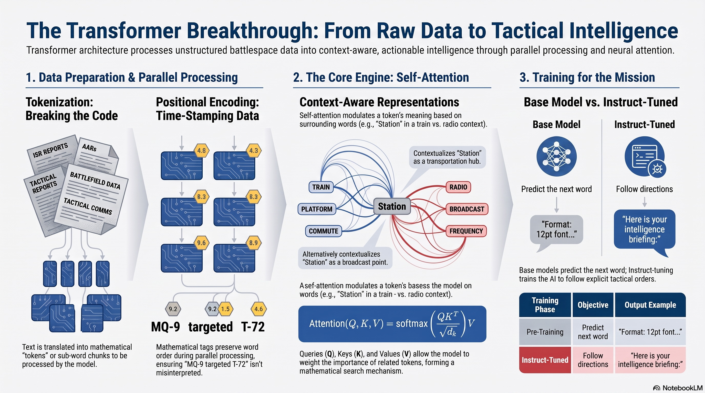

# L33: Transformers and LLMs

You have almost certainly used a large language model this year: to explain an error message, summarize a reading, or draft an email. In this lesson we open the box. By the end, you should be able to explain what happens between the moment you press Enter and the moment text starts appearing, and you should be able to call an LLM from your own Python code.

Language was one of the hardest problems in AI. A word's meaning depends on context ("bank" in "river bank" vs. "bank account"), sentences can be arbitrarily long, and word order matters. In L27, Naive Bayes threw word order away entirely (bag of words). Starting in 2017, a new architecture changed the field: the {term}`Transformer`, introduced in the paper *"Attention Is All You Need"* {cite:p}`Vaswani2017`. It showed that a mechanism called **attention** could model language without the slow, one-word-at-a-time processing of older recurrent networks (L30). Scaled up, Transformers became {term}`Large Language Models (LLMs) <Large Language Model (LLM)>`. Much of this lesson's treatment of attention follows *Deep Learning with Python* {cite:p}`chollet2021deep`.

:::{admonition} Lesson Objectives
:class: note

* Explain tokenization, positional encoding, and self-attention
* Describe the pre-training and instruct-tuning paradigms
* Interact with LLMs using APIs
:::

:::{admonition} Applications
:class: tip
- **Coding assistants:** An editor plug-in sends your code and question to an LLM API and streams back an explanation or a fix.

- **Customer support:** A help-desk bot answers routine questions and hands harder ones to a person.

- **Report summarization:** A unit receives dozens of After Action Reports (AARs) each week. An LLM drafts a one-paragraph summary of each so analysts can decide which full reports to read first.

- **Search over your own documents:** A course or a squadron connects an LLM to its own manuals so answers come from approved sources (retrieval-augmented generation, covered in a later lesson).
:::

<br>
<hr width="100%" size="4" color="black">

## The Big Picture: What Happens When You Send a Prompt

Before the details, here is the whole pipeline. Every step is covered below.

| Step | What happens | Section |
|---|---|---|
| 1. Tokenize | Your text is split into tokens, and each token becomes an integer ID | Tokens and Positions |
| 2. Embed | Each ID is looked up in a table to get a vector; position information is added | Tokens and Positions |
| 3. Transform | The vectors pass through a stack of Transformer blocks; self-attention lets every token gather context from the others | Self-Attention; Inside a Transformer Block |
| 4. Predict | The final vector is turned into a probability for every token in the vocabulary | Generating Text |
| 5. Sample and repeat | One token is chosen, appended, and the whole process repeats until the reply is done | Generating Text |
| 6. Return | An API sends the generated text, plus token counts, back to your program | Working with LLM APIs |

The surprising part is step 5: an LLM writes its reply **one token at a time**, feeding each new token back in as input. Everything it produces, from a poem to a Python function, is built from repeated next-token predictions.

<br>
<hr width="100%" size="4" color="black">

## Tokens and Positions

### Breaking Text Into Pieces (Tokenization)

Neural networks do math on numbers, not letters. Before an LLM can read anything, the text must be converted to numbers through {term}`Tokenization`.

If you have written a compiler or interpreter, you already know the idea: a **lexer** turns a stream of characters into a stream of tokens. An LLM tokenizer does the same thing, but its tokens are not words or keywords. They are frequent chunks of text, often **sub-words**:

* Common words are usually a single token: "the", "and", "network".
* Rare or invented words are split into pieces. A term like "multirotor" might be split into something like "multi" + "rot" + "or", depending on the tokenizer.
* Spaces, punctuation, and capitalization matter. " Hello" (with a leading space) and "Hello" are often different tokens.

Each token in the model's vocabulary has an integer **token ID**. A typical vocabulary has tens of thousands to a few hundred thousand entries; GPT-2, for example, used 50,257 tokens {cite:p}`Radford2019`.

Why sub-words instead of whole words? A whole-word vocabulary cannot handle words it has never seen (the same zero-count problem as Naive Bayes in L27). A character-level vocabulary handles everything but makes sequences very long. Sub-words are the compromise: frequent words stay whole, and any new word can still be spelled out of smaller pieces.

### How a Tokenizer Learns Its Vocabulary: Byte-Pair Encoding

Most LLM tokenizers are built with {term}`byte-pair encoding (BPE) <Byte-Pair Encoding (BPE)>` or a close relative {cite:p}`Sennrich2016`. The algorithm is simple enough to run by hand:

1. Start with every word split into single characters, plus an end-of-word marker `_`.
2. Count every adjacent pair of symbols across the training text.
3. Merge the most frequent pair into a new symbol and add it to the vocabulary.
4. Repeat until the vocabulary reaches the desired size.

> **Example 33.1 - Byte-Pair Encoding by Hand**
> A tiny training corpus contains five words with these counts: "run" (6), "runs" (2), "running" (4), "fun" (3), "sun" (2). Each word starts as characters: `r u n _`, `f u n _`, and so on.
>
> **Merge 1:** The pair `u n` appears in every word: $6 + 2 + 4 + 3 + 2 = 17$ times, the most of any pair. Merge it into `un`.
>
> **Merge 2:** Now `r un` appears in "run", "runs", and "running": $6 + 2 + 4 = 12$ times. Merge it into `run`.
>
> **Merge 3:** Now `run _` (the whole word "run") appears 6 times, beating `un _` (5, from "fun" and "sun"). Merge it into `run_`.
>
> After three merges, "run" is a single token, and "running" is `run` + `n` + `i` + `n` + `g` + `_`.
>
> **New word:** The tokenizer has never seen "rerunning". Applying the same merges in order gives `r` + `e` + `run` + `n` + `i` + `n` + `g` + `_`. It still works, because unfamiliar words fall back to smaller pieces. A real tokenizer runs tens of thousands of merges over billions of words, so "running" and many prefixes like "re" end up as single tokens.

:::{admonition} Why Tokens Matter to You as a Programmer
:class: important
Tokens are the unit of everything practical about LLMs. The model's {term}`Context Window` (the maximum input plus output it can handle at once) is measured in tokens. API usage is billed per token. Generation speed is measured in tokens per second. A handy rule of thumb for English text is that one token is about three-quarters of a word, or about four characters, but code, numbers, and other languages often use more tokens per word.
:::

### From Token IDs to Vectors (Embeddings)

A token ID like 4,521 is just a label; its size means nothing. The model's first layer is a {term}`token embedding <Token Embedding>` table: a matrix with one row per vocabulary entry. Looking up a token's row gives a vector (GPT-2's smallest version used 768 numbers per token). In code, this is literally array indexing:

```python
embedding_table.shape   # (vocab_size, d_model), e.g., (50257, 768)
x = embedding_table[token_ids]   # one 768-number vector per token
```

The table starts random and is learned during training, just like the weights in L28 and L29. Tokens used in similar ways end up with similar vectors.

### Keeping Track of Word Order (Positional Encoding)

Older recurrent networks (L30) read text one token at a time, which made them slow to train. A Transformer processes all tokens **in parallel**. That is a huge speed advantage on GPUs, but it creates a problem: attention, as we will see, compares every token with every other token without caring where they are. On its own, it treats the input as a bag of words (L27). "The dog bit the man" and "The man bit the dog" would look identical.

The fix is {term}`Positional Encoding`: before the token vectors enter the Transformer blocks, information about each token's position is added to its vector. The original Transformer added fixed sine and cosine patterns of different frequencies, so that every position gets a unique signature and nearby positions get similar signatures {cite:p}`Vaswani2017`:

$$PE_{(pos,\,2i)} = \sin\!\left(\frac{pos}{10000^{2i/d}}\right) \qquad PE_{(pos,\,2i+1)} = \cos\!\left(\frac{pos}{10000^{2i/d}}\right)$$

Later models use variations: GPT-2 learned a separate position vector for each position, and many recent open models use {term}`rotary position embeddings (RoPE) <Rotary Position Embedding (RoPE)>`, which rotate the query and key vectors by an angle that depends on position {cite:p}`Su2024`. The goal is the same in every case: let the model tell the subject from the object, and the first instruction from the last.

<br>
<hr width="100%" size="4" color="black">

## Self-Attention

### Context-Aware Tokens

You have already seen simple forms of "attention." Max pooling in a CNN (L31) looks at a region and keeps just one value: an all-or-nothing choice about what matters.

Language needs something richer, because the meaning of a word depends on the words around it. Is a "station" a train station, a radio station, or a space station? After the embedding lookup, "station" has one fixed vector no matter what sentence it is in. That is not how language works.

{term}`Self-Attention` fixes this by updating each token's vector using the vectors of the other tokens in the sequence. After attention, "station" in "The train left the station" carries some of the meaning of "train," while "station" in "Tune the radio to a different station" carries some of "radio." The result is a set of **context-aware** token representations.

### A Programmer's View: Attention Is a Soft Dictionary Lookup

The standard terms, {term}`query, key, and value <Query, Key, and Value (Attention)>`, come from data structures you already know. A Python dictionary does a *hard* lookup:

```python
facts = {"train": "rail vehicle", "radio": "broadcast device"}
facts["train"]          # exact key match -> one value
```

Attention does a *soft* lookup. Instead of requiring an exact key match, it compares the **query** against **every key**, scores how similar each one is, and returns a **weighted blend of all the values**, with the most similar keys contributing the most.

| Term | Dictionary analogy | In self-attention |
|---|---|---|
| **Query (Q)** | The key you are looking up | What the current token is looking for |
| **Key (K)** | The dictionary's keys | What each token offers to be matched against |
| **Value (V)** | The stored values | The information each token passes along if it is matched |

In self-attention, the queries, keys, and values all come from the **same sequence**, but they are not identical copies. Each token's vector $x$ is multiplied by three separate learned weight matrices to produce its query $q = xW_Q$, key $k = xW_K$, and value $v = xW_V$. These matrices are learned during training, so the model learns *what to look for* and *what to offer*.

### The Formula

For all tokens at once, the calculation ({term}`Scaled Dot-Product Attention`) is written:

$$\text{Attention}(Q, K, V) = \text{softmax}\left(\frac{QK^T}{\sqrt{d_k}}\right)V$$

Read it in three steps:

1. **Score:** $QK^T$ takes the dot product of each query with each key. A large dot product means "this key matches what I am looking for."
2. **Scale and normalize:** Divide by $\sqrt{d_k}$ (the square root of the key length) to keep the scores from growing too large, then apply {term}`softmax <Softmax>` so each token's scores become positive weights that sum to 1. (Softmax is the multi-class version of the sigmoid from L28.)
3. **Blend:** Multiply the weights by $V$, giving each token a weighted average of all the value vectors.

> **Example 33.2 - Computing Attention by Hand**
> Take a three-token sequence: "train", "left", "station". To keep the numbers small, use 2-dimensional vectors that have already been through the learned projections. We compute the new representation for "station."
>
> | Token | Key $k$ | Value $v$ |
> |---|---|---|
> | train | [2, 2] | [1, 0] |
> | left | [0, 1] | [0, 1] |
> | station | [1, 1] | [0.5, 0.5] |
>
> The query for "station" is $q = [1, 2]$.
>
> **Step 1: Scores (dot products).**
> * train: $1 \times 2 + 2 \times 2 = 6$
> * left: $1 \times 0 + 2 \times 1 = 2$
> * station: $1 \times 1 + 2 \times 1 = 3$
>
> **Step 2: Scale and softmax.** With $d_k = 2$, divide by $\sqrt{2} \approx 1.414$: scores become 4.24, 1.41, and 2.12. Softmax turns these into weights of about **0.85, 0.05, and 0.10**. They sum to 1.
>
> **Step 3: Weighted sum of values.**
> $$0.85 \times [1, 0] + 0.05 \times [0, 1] + 0.10 \times [0.5, 0.5] \approx [0.90, 0.10]$$
>
> **Result:** "Station" now has a vector dominated by the value from "train" (85% of the weight). The model has learned, through its $W_Q$ and $W_K$ matrices, that a station's meaning depends heavily on a nearby vehicle word. In a real model the vectors have hundreds of dimensions and every token does this simultaneously.

### Causal Masking: No Peeking at the Future

LLMs that generate text, such as the GPT family, Claude, and Llama, are trained to predict the next token. If a token could attend to the tokens *after* it during training, it could simply copy the answer. To prevent this, these models apply a {term}`causal mask <Causal Masking>`: before the softmax, every score for a later position is set to $-\infty$, so its weight becomes exactly 0. Each token can attend only to itself and to earlier tokens. This is why these models are called {term}`decoder-only <Decoder-Only Transformer>` or *causal* language models.

### Multi-Head Attention

A single attention calculation captures one kind of relationship. {term}`Multi-head attention <Multi-Head Attention>` runs several attention calculations in parallel, each with its own $W_Q$, $W_K$, and $W_V$, and then concatenates the results. One head might learn to link pronouns to the nouns they refer to, another to link verbs to their subjects, another to track nearby punctuation. The original Transformer used 8 heads; large models use dozens.

### The Cost of Attention

Every token compares itself with every other token, so attention computes $n \times n$ scores for a sequence of $n$ tokens. A 1,000-token prompt needs 1 million scores per head per layer; a 100,000-token prompt needs 10 billion. Doubling the context length roughly **quadruples** the attention work. This $O(n^2)$ cost is a major reason context windows have limits, and why long prompts are slower and more expensive.

<br>
<hr width="100%" size="4" color="black">

## Inside a Transformer Block

Self-attention is the key new idea, but a Transformer is built by stacking many identical {term}`blocks <Transformer Block>`, and each block reuses tools from earlier lessons:

1. **Multi-head self-attention** gathers context from other tokens.
2. A **residual connection** (L30) adds the block's input back to the attention output, so gradients have a direct path through very deep stacks.
3. {term}`Layer normalization <Layer Normalization>` rescales each token's vector to a steady range (similar in spirit to batch normalization, L30).
4. A small **feed-forward network**, an MLP like the ones in L28, processes each token's vector independently.
5. Another residual connection and normalization.

GPT-2's smallest version stacks 12 of these blocks; the largest modern models stack around 100 or more. Early blocks tend to capture local and grammatical patterns, and later blocks capture more abstract meaning: the same hierarchy idea as CNN layers in L30 and L31.

| Model family | Attention pattern | Typically used for | Examples |
|---|---|---|---|
| Encoder-only | Every token sees every other token | Understanding: classification, search embeddings | BERT {cite:p}`Devlin2019` |
| Decoder-only | Causal mask: tokens see only the past | Generating text: chat assistants, code completion | GPT, Claude, Llama |
| Encoder-decoder | Encoder reads input; decoder generates output | Translation, summarization | Original Transformer |

<br>
<hr width="100%" size="4" color="black">

## Generating Text

### From Vectors to the Next Token

After the last Transformer block, the vector at the final position is multiplied by one more weight matrix that produces a score, called a {term}`logit <Logits>`, for **every token in the vocabulary**. Softmax turns those logits into a probability distribution over the next token. {term}`Next-token prediction <Next-Token Prediction>` is therefore just **classification** with tens of thousands of classes, trained with the cross-entropy loss from L29.

Generation is a loop:

```python
tokens = tokenize(prompt)
while not done:
    probs = model(tokens)            # probabilities for the next token
    next_token = sample(probs)       # choose one
    tokens.append(next_token)        # feed it back in
    done = (next_token == END) or (len(tokens) >= limit)
return detokenize(tokens)
```

This is called {term}`autoregressive generation <Autoregressive Generation>`: each output becomes part of the next input. It explains several things you have probably noticed. Responses appear word by word (each token is a new loop iteration), long answers take longer, and a model cannot "go back" and revise a token it has already emitted.

### Temperature: Controlling Randomness

The `sample` step does not have to pick the most likely token. **Temperature** controls how adventurous it is ({term}`Temperature (Sampling)`): the logits are divided by the temperature $T$ before the softmax.

> **Example 33.3 - Temperature in Action**
> After "The train left the", the model's logits for four candidate tokens are: "station" 3.0, "platform" 2.0, "city" 1.0, "banana" $-1.0$.
>
> | Temperature | station | platform | city | banana |
> |---|---|---|---|---|
> | $T = 0.5$ (focused) | 0.87 | 0.12 | 0.02 | 0.00 |
> | $T = 1.0$ (default) | 0.66 | 0.24 | 0.09 | 0.01 |
> | $T = 2.0$ (creative) | 0.47 | 0.29 | 0.17 | 0.06 |
>
> **Result:** Low temperature sharpens the distribution toward the top choice, which suits factual answers, code, and data extraction. High temperature flattens it, which produces more varied, creative text but also more odd choices. At temperature near 0, the model nearly always picks the single most likely token, so repeated calls give very similar answers.

Many APIs also offer {term}`top-p (nucleus) sampling <Top-p (Nucleus) Sampling>`, which samples only from the smallest set of tokens whose probabilities add up to $p$.

### Why LLMs Hallucinate

The model is trained to produce *likely* text, not *verified* text. If the most probable continuation of a sentence is a plausible-sounding but false citation, the model can produce it with complete fluency. This is called {term}`hallucination <Hallucinations>`, and it follows directly from next-token prediction. It is why LLM output must be checked, why grounding answers in retrieved documents helps, and why consequential decisions need human review.

<br>
<hr width="100%" size="4" color="black">

## Training Paradigms: Base vs. Instruct

### Learning the Language vs. Following Instructions

Suppose you download a freshly trained model and ask it to write a summary. It may ignore you completely. Why? Because of how it was trained. Modern assistants are built in stages.

**Stage 1: Pre-Training (The Base Model)**

In {term}`Pre-Training`, the model reads an enormous amount of text (web pages, books, code, encyclopedias) and plays one game: *predict the next token*. Llama 2, for example, was pre-trained on about 2 trillion tokens {cite:p}`Touvron2023`. Along the way it absorbs grammar, facts, writing styles, and some reasoning patterns. This is by far the most expensive stage, and it is the same idea as the foundation models in L30.

The result is a {term}`Base Model`. A base model is a superb **document completer**, like your phone keyboard's autocomplete scaled up enormously. It does not know it is supposed to be an assistant. Give it *"Write a summary of this report:"* and it may continue as if it were in the middle of a form or a homework assignment: *"Due Friday. Summaries must be under 300 words and double-spaced."* It is just completing a plausible document.

**Stage 2: Supervised Fine-Tuning (SFT)**

In {term}`Supervised Fine-Tuning (SFT)`, the base model is fine-tuned on thousands to millions of example conversations, each pairing an instruction with a high-quality response written or reviewed by people. Training is still next-token prediction (and still cross-entropy loss), but now on documents that look like *"a user asks; a helpful assistant answers."* The model learns the format and habit of answering.

**Stage 3: Preference Tuning (RLHF and Related Methods)**

Demonstrations alone cannot show every kind of good and bad answer. In {term}`reinforcement learning from human feedback (RLHF) <Reinforcement Learning from Human Feedback (RLHF)>`, people compare pairs of model responses and pick the better one; a reward model learns to predict those preferences, and the LLM is then trained to produce responses the reward model rates highly {cite:p}`Ouyang2022`. (This is the reinforcement learning from earlier in the course, with a learned reward.) Newer methods, such as direct preference optimization, learn from the same comparisons without a separate reward model {cite:p}`Rafailov2023`. This stage pushes the model toward responses that are helpful, honest, and harmless, including declining harmful requests.

Together, stages 2 and 3 are what this course calls {term}`Instruct-Tuning`. The effect is striking: in the InstructGPT study, people preferred the outputs of a 1.3-billion-parameter instruction-tuned model over those of the 175-billion-parameter base GPT-3 model {cite:p}`Ouyang2022`. Instruction tuning changes behavior far more than raw size does.

Instruction tuning does **not** make a model always correct or perfectly obedient. Instruct models still hallucinate, can misread instructions, and can be manipulated by cleverly crafted inputs ({term}`Prompt Injection`).

| | Base model | Instruct (chat) model |
|---|---|---|
| Trained by | Pre-training only | Pre-training, then SFT and preference tuning |
| Behaves like | A document completer | An assistant that answers |
| Given "Translate this to French:" | May continue with more instructions or a similar prompt | Produces the translation |
| Typical use | Research, further fine-tuning | Chat apps and most API use |

### Chat Templates: How Roles Become Text

The model itself only ever sees one long sequence of tokens. When you send a conversation with "system," "user," and "assistant" roles, the provider converts it into a single string using a {term}`chat template <Chat Template>`: special marker tokens that separate the turns, in exactly the format used during instruction tuning. The model then predicts the tokens that come after the final "assistant" marker. This is the bridge between the training stages above and the API calls below.

<br>
<hr width="100%" size="4" color="black">

## Working with LLM APIs

### What an LLM API Is

An {term}`API (Application Programming Interface)` for an LLM is an HTTPS endpoint, much like any REST API you have used. Your program sends a JSON request containing a list of messages, and the provider runs the model on its servers and sends back a JSON response with the generated text and how many tokens were used. Major providers (Anthropic, OpenAI, Google) and local model servers all follow this same basic pattern; names of fields and parameters differ slightly between them.

### Anatomy of a Request

The examples below use Anthropic's Messages API. A raw HTTP request looks like this:

```bash
curl https://api.anthropic.com/v1/messages \
  -H "x-api-key: $ANTHROPIC_API_KEY" \
  -H "anthropic-version: 2023-06-01" \
  -H "content-type: application/json" \
  -d '{
        "model": "claude-haiku-4-5-20251001",
        "max_tokens": 300,
        "system": "You are a concise teaching assistant for a CS course.",
        "messages": [
          {"role": "user", "content": "What is a context window, in one sentence?"}
        ]
      }'
```

| Field | Purpose |
|---|---|
| `model` | Which model to run. Larger models are more capable; smaller ones are faster and cheaper. Model names change over time, so check your provider's current list. |
| `max_tokens` | The maximum number of tokens to generate. The reply stops here even if unfinished. |
| `system` | The {term}`system prompt <System Prompt>`: standing instructions about role, tone, format, and rules that apply to the whole conversation. |
| `messages` | The conversation so far, as a list of `user` and `assistant` turns. |
| `temperature` (optional) | Randomness of sampling (Example 33.3). |

The {term}`API key <API Key>` identifies you and is used for billing. Treat it like a password.

### Calling an LLM from Python

In practice you will use the provider's software development kit (SDK), which wraps the HTTP request:

```python
import anthropic

MODEL = "claude-haiku-4-5-20251001"   # check the provider's docs for current model names
client = anthropic.Anthropic()        # reads the ANTHROPIC_API_KEY environment variable

response = client.messages.create(
    model=MODEL,
    max_tokens=300,
    temperature=0.2,
    system="You are a concise teaching assistant for a CS course.",
    messages=[{"role": "user", "content": "What is a context window, in one sentence?"}],
)

print(response.content[0].text)                                   # the generated reply
print(response.usage.input_tokens, response.usage.output_tokens)  # what you are billed for
print(response.stop_reason)   # "end_turn" (finished) or "max_tokens" (cut off)
```

Check `stop_reason`. If it says the reply hit `max_tokens`, your answer was truncated, which is a common source of half-finished JSON and code.

### The API Is Stateless: You Send the Whole Conversation

The model does not remember previous requests. Each API call is independent: it is a {term}`stateless API <Stateless API>`, like a stateless REST request. A chat app *appears* to remember because the client resends the entire conversation history with every new message:

```python
history = []

def chat(user_text):
    history.append({"role": "user", "content": user_text})
    reply = client.messages.create(model=MODEL, max_tokens=300, messages=history)
    text = reply.content[0].text
    history.append({"role": "assistant", "content": text})   # keep the reply for next time
    return text

chat("My name is Sam.")
chat("What is my name?")   # works only because the first exchange is resent in `history`
```

> **Example 33.4 - The Hidden Cost of a Long Chat**
> Each exchange in a conversation (one question plus one answer) adds about 500 tokens to the history. Because the full history is resent every time, the input tokens grow with each turn:
>
> * Turn 1 sends about 500 tokens, turn 2 about 1,000, turn 3 about 1,500, and so on.
> * Over 10 turns: $500 + 1{,}000 + \dots + 5{,}000 = 500 \times (1 + 2 + \dots + 10) = 500 \times 55 = 27{,}500$ input tokens.
>
> **Result:** Ten turns that each add only 500 tokens cost 27,500 input tokens in total, because total cost grows with the square of the number of turns. Long conversations eventually also hit the context window. Apps manage this by trimming or summarizing old turns.

### Tokens, Context, and Cost

> **Example 33.5 - Budgeting a Summarization Job**
> A unit wants an LLM to summarize a 15,000-word After Action Report into a 300-word summary.
>
> * Input: about $15{,}000 / 0.75 = 20{,}000$ tokens (using the three-quarters-of-a-word rule of thumb).
> * Output: about $300 / 0.75 = 400$ tokens.
> * **Context check:** 20,400 tokens fits easily within the context windows of current production models, which are typically 100,000 tokens or more. A very long report collection might not, and would need to be split into chunks.
> * **Cost check (illustrative prices):** At \$1 per million input tokens and \$5 per million output tokens, one summary costs about $20{,}000 \times \$1/10^6 + 400 \times \$5/10^6 = \$0.020 + \$0.002 = \$0.022$. Fifty reports a week cost about \$1.10.
>
> **Result:** For summarization, input tokens dominate the cost. Real prices vary widely by model and provider, so always check the current pricing page, but the method of estimating is the same.

### Getting Structured Output

Programs usually need data, not prose ({term}`Structured Output`). Ask for a specific format in the system prompt, give an example, use a low temperature, and **always validate** what comes back:

```python
import json

system = ('Extract fields from the report. Reply with JSON only, in exactly this form: '
          '{"unit": string, "date": string, "issues": [string]}')
reply = client.messages.create(model=MODEL, max_tokens=500, temperature=0,
                               system=system,
                               messages=[{"role": "user", "content": report_text}])
try:
    data = json.loads(reply.content[0].text)
except json.JSONDecodeError:
    data = None   # retry, log, or send to a human: never assume the format is correct
```

Many providers also offer dedicated features for structured output and for "tool use," where the model returns a structured request for your code to run a function. Those build directly on this pattern and are part of the agentic AI lessons.

### Prompting Is Part of Programming

The system prompt and messages are your interface to the model, and small changes matter ({term}`Prompt Engineering`). Practices that work across providers:

* **Be specific.** State the role, the task, the audience, the length, and the output format.
* **Show examples.** A few input-output examples in the prompt ({term}`Few-Shot Prompting`) often beat long descriptions.
* **Separate instructions from data.** Put documents inside clear markers (for example, `<report>...</report>`) so the model can tell your instructions from the text it is processing.
* **Ask for verifiable output.** Request quotes or citations from the provided text so you can check claims.

### Errors, Limits, and Reliability

Network services fail, and LLM APIs add their own limits:

* {term}`Rate limits <Rate Limit>`: Providers cap requests and tokens per minute. Exceeding them returns an HTTP 429 error. The standard fix is to retry with {term}`exponential backoff <Exponential Backoff>`: wait 1 second, then 2, then 4, and so on. Most SDKs retry a few times automatically.
* **Server errors:** 5xx errors are usually temporary and are also worth retrying.
* **Truncation:** Check `stop_reason`, as above.
* **Variability:** The same prompt can produce different answers. Use low temperature for consistency, and test your prompts on many inputs, not just one.

```python
import time

def call_with_retry(**kwargs):
    for attempt in range(4):
        try:
            return client.messages.create(**kwargs)
        except anthropic.RateLimitError:
            time.sleep(2 ** attempt)          # 1, 2, 4, 8 seconds
    raise RuntimeError("Gave up after repeated rate-limit errors")
```

### Security and Responsible Use

:::{admonition} Rules for Using LLM APIs
:class: warning
* **Protect your API key.** Store it in an environment variable or a secrets manager. Never hard-code it or commit it to GitHub; leaked keys are found by automated scanners within minutes and can run up large bills.
* **Know where your data goes.** Text sent to a commercial API leaves your network. Never send classified information, Controlled Unclassified Information (CUI), passwords, or personal data to a service that is not approved for it. Government and military users must use accredited environments; organizations that cannot send data out may run {term}`open-weight models <Open-Weight Model>` on their own approved hardware.
* **Treat model output as untrusted input.** Validate it before using it in code, and never execute generated commands or code without review.
* **Watch for prompt injection.** Text the model reads (a web page, an email, a document) can contain instructions that try to override yours {cite:p}`Greshake2023`. This matters most when a model can take actions.
* **Keep a human accountable.** LLMs can be fluent and wrong. A person must review outputs that inform consequential decisions.
:::

<br>
<hr width="100%" size="4" color="black">

## Summary

* **Tokenization** splits text into sub-word tokens using a learned vocabulary (often built with byte-pair encoding). Tokens are the unit of context limits, speed, and cost.
* **Embeddings** turn token IDs into vectors, and **positional encoding** adds word-order information that parallel processing would otherwise lose.
* **Self-attention** is a soft dictionary lookup: each token's query is compared with every key, softmax turns the scores into weights, and the token's new vector is a weighted blend of the values. Q, K, and V come from the same sequence through different learned matrices.
* **Causal masking** stops generating models from looking ahead; **multi-head attention** captures several relationships at once; attention cost grows with the square of the sequence length.
* A **Transformer block** combines attention with residual connections, normalization, and a feed-forward network. Many blocks are stacked.
* LLMs **generate one token at a time**. Temperature controls how random each choice is, and next-token prediction explains why models can hallucinate.
* A **base model** from pre-training completes documents; **instruction tuning** (supervised fine-tuning plus preference tuning such as RLHF) turns it into an assistant.
* **LLM APIs** are stateless HTTPS calls: you send a model name, a system prompt, the full message history, and generation settings, and you get back text, a stop reason, and token counts. Budget tokens, validate outputs, retry on rate limits, protect your key, and never send data the service is not approved to handle.

## Summary Infographic


<br>
<hr width="100%" size="4" color="black">

## Knowledge Check & Practice Questions

1. **The Order of Operations:** If a Transformer processes an entire sentence simultaneously in parallel, how does the model mathematically know which word came first and which came last?

2. **Self-Attention in Action:** In the sentence, *"The pilot landed the damaged aircraft safely because she was highly trained,"* which previous word in the sequence will the self-attention mechanism mathematically link the word *"she"* to with the highest attention weight?

3. **Base vs. Instruct:** You are deployed to a forward operating base and given a locally hosted LLM. When you type *"Translate this intercepted message into English:"*, the model replies by outputting *"Translate this intercepted message into Spanish:"*. What training phase has this model likely missed, and why is it behaving this way?

4. Using the five-word corpus from Example 33.1, explain why the first merge is `u n` rather than `r u`. How would the tokenizer split the unseen word "funs"?

5. A query vector is $q = [2, 0]$. The keys are $k_1 = [1, 0]$ and $k_2 = [0, 1]$, with values $v_1 = [10, 0]$ and $v_2 = [0, 10]$, and $d_k = 2$. Compute the scaled scores, the softmax weights (to two decimal places), and the attention output.

6. In self-attention, the queries, keys, and values all come from the same sequence. Why does the model still need three separate learned weight matrices instead of using each token's vector directly for all three?

7. Why do generating models such as GPT and Claude use a causal mask during training? What would go wrong without it?

8. A prompt grows from 2,000 to 8,000 tokens. Roughly how many times more attention scores must each attention head compute per layer?

9. You are writing a program that extracts dates and unit names from reports and saves them to a database. What temperature would you choose, and what should your code do after receiving each response?

10. A student's chatbot "forgets" everything the user said earlier in the conversation. Based on how LLM APIs work, what is the most likely bug in their code?

11. A classmate pastes their API key directly into a Python notebook and pushes it to a public GitHub repository. List two risks and the correct way to store the key.