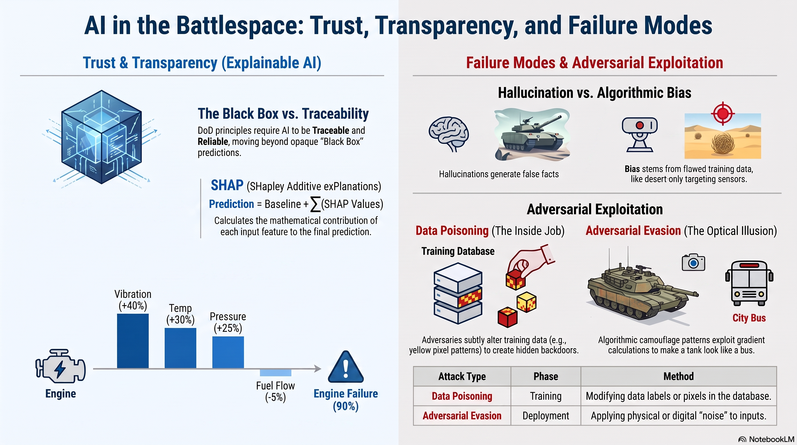

# L36: Failure Modes and Ethics

So far in this course we have mostly asked, "How well does the model work?" This lesson asks the harder questions: **How does it fail? Who is affected when it does? Can we tell why it made a decision? And what happens when someone is actively trying to make it fail?**

These questions matter wherever AI makes or informs decisions: who gets a loan, which résumé a recruiter sees, which medical scan a doctor reviews first, which network alert an analyst investigates, and which object a drone's camera flags. In defense systems the stakes are highest, because an adversary is *trying* to make the model fail, and a failure can cost lives. If people cannot understand why a system made a recommendation, or if an adversary can manipulate what it perceives, the system becomes a vulnerability rather than an asset.

This lesson pulls together failure modes you have already met (overfitting in L26, distribution shift in L30, shortcut learning in L31, hallucination in L33, prompt injection in L33 to L35) and adds three new topics: **bias and fairness, explainability, and deliberate attacks.**

:::{admonition} Lesson Objectives
:class: note

* Identify hallucinations and bias in AI systems.

* Identify how ethical issues stem from bias in training data, algorithms, and human-defined rules.

* Explain the necessity of Explainable AI (XAI) for mission-critical systems.

* Evaluate deployment risks including data poisoning and adversarial evasion.
:::

:::{admonition} Applications
:class: tip
- **Hiring and lending:** Automated screening must not systematically disadvantage applicants because of characteristics unrelated to the job or the loan.

- **Health care:** A risk score that decides which patients get extra care must work equally well for every patient group.

- **Cybersecurity:** Malware classifiers and spam filters face attackers who constantly modify their files and messages to slip past the model.

- **Defense:** Target-recognition and threat-detection systems must be explainable to the people accountable for their use, and robust against camouflage, decoys, and tampered training data.
:::

 

## A Map of How AI Systems Fail

It helps to sort failures by **when** they enter the system and **whether anyone intended them**.

| Stage | Unintended failure | Deliberate attack |
|---|---|---|
| **Data collection and labeling** | Unrepresentative or historically biased data; label errors | {term}`Data Poisoning` |
| **Problem formulation and training** | Proxy labels; optimizing only for overall accuracy; overfitting (L26) | Backdoor insertion through poisoned data or a tampered pre-trained model |
| **Deployment** | {term}`Distribution Shift (Domain Shift)` (L30); hallucination (L33); thresholds and rules set by people | {term}`Adversarial Evasion`; {term}`Prompt Injection` (L33 to L35) |
| **Use by people** | {term}`Automation Bias`: over-trusting the output; or ignoring correct alerts | Social engineering of the operators |

The rest of the lesson follows this map: hallucination and bias (unintended), explainability (how we detect and question failures), and attacks (intended).

 

## Hallucinations

### The Illusion of Truth

As we saw in L33, an LLM is trained to predict statistically likely next tokens. It has no built-in check on whether a sentence is *true*. When it lacks knowledge, it rarely says "I don't know" on its own; it produces a fluent, plausible continuation. The result is a {term}`hallucination <Hallucinations>`: false or fabricated content presented with the same confidence as correct content.

Common forms include invented citations and quotes, wrong numbers or dates, nonexistent software functions, and confident summaries of documents that say something else.

Hallucination is a **failure mode, not a bug to be patched once**. Lessons L34 and L35 showed the main mitigations, and each reduces the problem without eliminating it:

* **Grounding with retrieval (RAG, L35):** answer only from retrieved sources, with citations, and say "not found" when the answer is absent.
* **Prompting (L34):** ask for reasoning, give an honest way out, and avoid leading questions that invite agreement.
* **Verification:** check citations, numbers, and code with real tools or people. A model's claim that it "verified" something is not verification.

Hallucination is also an ethics issue. A fabricated legal citation, medical fact, or intelligence detail can harm people who trust it, so systems must be designed so that a human can check the output before it matters.

 

## Bias in AI Systems

### Two Meanings of "Bias"

The word "bias" means two different things in this course, and mixing them up causes real confusion.

| | Statistical bias (L26) | Algorithmic (societal) bias |
|---|---|---|
| **Meaning** | Error from a model that is too simple to fit the data | Systematically worse or unfair results for some group of people or some kind of situation |
| **Symptom** | Poor accuracy on training *and* test data ({term}`Underfitting (High Bias)`) | Good overall accuracy that hides much worse accuracy for a subgroup |
| **Typical fix** | A more flexible model | Better data, better objectives and metrics, and better rules for how the output is used |

A model can have *low* statistical bias and still show severe algorithmic bias. In fact, a very flexible model trained on skewed data can learn that skew very precisely.

{term}`Algorithmic Bias` occurs when a model produces systematically skewed results for particular groups or situations. These problems rarely come from anyone intending harm. They come from three sources.

### Source 1: Bias in the Training Data

A model can only learn the world its data shows it.

* **Unrepresentative data:** A face-analysis system trained mostly on lighter-skinned faces performs worse on darker-skinned faces. An audit of commercial gender-classification systems found error rates up to 34.7% for darker-skinned women, compared with at most 0.8% for lighter-skinned men {cite:p}`Buolamwini2018`. Commercial speech-recognition systems have shown roughly twice the word error rate for Black speakers as for white speakers {cite:p}`Koenecke2020`.
* **{term}`Historical bias <Historical Bias>`:** If past decisions were unfair, a model trained to imitate them learns the unfairness. A résumé screener trained on a company's past hiring decisions can learn to prefer whoever the company hired in the past.
* **Domain mismatch:** A target-recognition model trained mostly on desert imagery and deployed over snowy, urban terrain sees images unlike its training data. This is {term}`Distribution Shift (Domain Shift)` (L30), and its error rate can rise sharply, including false positives against civilian vehicles it has never learned to recognize.

### Source 2: Bias in the Training Algorithm and Objective

The objective we optimize decides what the model cares about.

* **Optimizing only overall accuracy** lets a model do well by serving the majority of cases and failing the rest. If 95% of examples come from one group, a model can reach high accuracy while performing poorly on the other 5%.
* **{term}`Proxy labels <Proxy Label>`:** Often we cannot measure what we really care about, so we train on a stand-in. A widely used U.S. health-care algorithm predicted patients' future health-care *costs* as a stand-in for their health *needs*. Because less money had historically been spent on Black patients with the same level of illness, the algorithm systematically underestimated how sick they were {cite:p}`Obermeyer2019`. The model predicted its label well; the label was the problem.

> **Example 36.1 - When 95% Accuracy Hides a Problem**
> A face-verification system controls entry to a campus building. It is tested on 1,000 attempts by people who **are** authorized: 800 from group A and 200 from group B.
>
> | Group | Attempts | Correctly accepted | Wrongly rejected | False rejection rate |
> |---|---|---|---|---|
> | A | 800 | 784 | 16 | $16/800 = 2\%$ |
> | B | 200 | 170 | 30 | $30/200 = 15\%$ |
> | **All** | **1,000** | **954** | **46** | **4.6%** |
>
> **Interpret:** Overall accuracy is $954/1{,}000 = 95.4\%$, which looks good. But a member of group B is wrongly locked out $15\% / 2\% = 7.5$ times as often as a member of group A. Group B is only 20% of the test set, so its errors barely move the overall number.
>
> **Lesson:** Always break evaluation results down by relevant subgroups and by operating conditions (day and night, terrain, sensor, language). The confusion matrices from L32 should be computed per group, not just overall.

There are several reasonable definitions of "fair" ({term}`fairness metrics <Fairness Metrics>`): equal accuracy across groups, equal false positive rates, equal false negative rates, and others. When groups have different base rates, a classifier generally **cannot satisfy all of them at once** {cite:p}`Chouldechova2017`. Choosing which kind of error to equalize is a value judgment that people, not the algorithm, must make and document.

### Source 3: Bias in Rules Set by People

AI systems operate inside rules that people write: thresholds, filters, escalation policies, and decisions about who reviews what.

* **Thresholds:** In L32 you chose a threshold from the costs of misses and false alarms. Those costs are human judgments. If the person setting the threshold overweights one kind of error, for example by setting a very low threshold for a "threat" alert out of excessive caution, the system will flag far more innocent cases, and that choice is encoded directly into every decision the system makes.
* **Scope and use:** Deciding where a system is deployed, on whom, and for what purpose can create unfairness even when the model itself is accurate.
* **Automation bias:** People tend to over-trust automated recommendations, accepting them without enough scrutiny, or to stop trusting a system entirely after a few false alarms {cite:p}`Parasuraman1997`. Either way, the human "check" stops working. Interfaces, training, and explanations must be designed so that operators can judge when to trust the system.

 

## Trust and Transparency: Explainable AI

### The Black Box Problem

Deep neural networks have millions or billions of parameters. We know exactly what arithmetic they perform, but it is very hard to trace *which* parts of an input caused a particular prediction or to say in human terms what the network has learned. This is why they are often called "black boxes."

For mission-critical systems, this is a serious problem. The U.S. Department of Defense's AI Ethical Principles require AI capabilities to be **Responsible, Equitable, Traceable, Reliable, and Governable** {cite:p}`DoD2020`. *Traceable* means the people involved understand the technology, its development processes, and its data sources, with transparent and auditable methods and documentation. *Governable* means humans can detect unintended behavior and disengage or deactivate a system that behaves badly. DoD policy on autonomy in weapon systems further requires that commanders and operators be able to exercise appropriate levels of human judgment over the use of force {cite:p}`DoD2023`. Civilian frameworks such as the NIST AI Risk Management Framework set out similar expectations for transparency, accountability, and managing risk across a system's life cycle {cite:p}`NIST2023`.

{term}`Explainable AI (XAI)` is the set of methods for helping people understand why a model produced its output. Explanations serve several purposes:

* **Verification:** An operator can check whether the evidence makes sense before acting on a recommendation.
* **Debugging:** Developers can catch shortcut learning, like the pneumonia model that learned hospital-specific image markers instead of disease (L31) {cite:p}`Zech2018`.
* **Accountability and appeal:** People affected by a decision can understand and challenge it.
* **Fairness audits:** Explanations can reveal that a model relies on a proxy for a protected characteristic.

### Kinds of Explanations

| Method | What it shows | Example |
|---|---|---|
| **Global feature importance** | Which inputs matter most to the model overall | "Vibration is the most important sensor for predicting engine failure" |
| **Local explanation (SHAP, LIME)** | Why the model made *this* prediction for *this* input | "This engine was flagged mainly because of its vibration reading" |
| **Saliency maps ({term}`Grad-CAM <Grad-CAM (Gradient-weighted Class Activation Mapping)>`)** | Which image regions drove a CNN's decision (L31) {cite:p}`Selvaraju2017` | A heatmap over the part of an image that triggered "vehicle" |
| **Documentation ({term}`model cards <Model Card>`)** | What the model is for, how it was trained and evaluated, and where it should not be used {cite:p}`Mitchell2019` | A one-page summary listing per-group accuracy and known limitations |

### SHAP: Splitting a Prediction Among Its Features

{term}`SHAP (SHapley Additive exPlanations)` is one of the most widely used local explanation methods {cite:p}`lundberg2017unified`. It comes from cooperative game theory: imagine the input features as players on a team that together "earned" the model's prediction, and ask how to divide the credit fairly. The Shapley value gives each feature its average contribution across all possible orders in which features could be added.

The key property is that the contributions **add up**:

$$\text{prediction} = \text{baseline} + \sum_{i} \phi_i$$

where the baseline is the model's average prediction over a reference dataset, and $\phi_i$ is the SHAP value of feature $i$: positive values push the prediction up, negative values push it down. A related method, {term}`LIME <LIME (Local Interpretable Model-agnostic Explanations)>`, explains a single prediction by fitting a simple model to the complex model's behavior near that input {cite:p}`Ribeiro2016`.

> **Example 36.2 - Explaining an Engine-Failure Alert**
> A predictive-maintenance model estimates the probability that an aircraft engine fails before its next scheduled inspection. Across the fleet, its average prediction (the baseline) is 10%. For one engine, it predicts **90%**. The SHAP values are:
>
> | Feature | SHAP value |
> |---|---|
> | Vibration sensor | +40 percentage points |
> | Exhaust gas temperature | +25 |
> | Oil pressure | +20 |
> | Fuel flow | −5 (argues against failure) |
>
> **Check the sum:** $10 + 40 + 25 + 20 - 5 = 90\%$.
>
> **Interpret:** Instead of acting on a bare "90% failure risk" alert, the maintainer sees that vibration and temperature drive the alert and can inspect those systems first. If the explanation instead showed that the alert was driven mostly by the *engine's serial number*, that would reveal a problem in the model or its data, not in the engine.

In practice, SHAP values for classifiers are often reported in log-odds rather than probability, and they are usually *estimated* rather than computed exactly, because the exact calculation considers every subset of features.

:::{admonition} The Limits of Explanations
:class: warning
* **An explanation describes the model, not the world.** SHAP says which features *the model* relied on. It does not say those features *cause* the outcome.
* **Explanations can be incomplete or misleading.** Different methods can disagree, and saliency maps can look plausible even for a poorly trained model.
* **LLM self-explanations are not guaranteed to be faithful.** An LLM's step-by-step reasoning (L34) may not reflect what actually drove its answer {cite:p}`Turpin2023`.
* **Explanations do not replace testing.** Per-group evaluation, robustness tests, and red-teaming are still required.
:::

 

## Adversarial Exploitation

So far, failures have been accidents. In security settings, an adversary deliberately tries to make the model fail. Cyber majors will recognize the mindset: **assume an attacker who knows how your system works.** The two classic attacks target different stages of the life cycle.

| | Data poisoning | Adversarial evasion |
|---|---|---|
| **When** | Training | Deployment |
| **What the attacker changes** | Training data or labels | Inputs to an already-trained model |
| **Attacker needs** | Access to the data pipeline or a data source the model trains on | The ability to change what the deployed model sees |
| **Classic example** | A hidden trigger pattern that causes a chosen output | Small, crafted changes that cause a confident misclassification |

### Data Poisoning: The Inside Job

{term}`Data Poisoning` corrupts the training data so the model learns something the attacker wants.

* **Label flipping:** Change labels on some examples (for example, relabel some military trucks as civilian) so the model learns a wrong boundary.
* **{term}`Backdoors <Backdoor Attack>` (trojans):** Add a small, specific trigger pattern to some training images and label them with the attacker's chosen class. The model learns "trigger means that class" while behaving normally on clean inputs, so standard testing does not reveal the problem {cite:p}`Gu2019`.

> **Example 36.3 - A Backdoor That Passes Every Test**
> An image classifier is trained on 50,000 images. An attacker with access to the labeling pipeline adds a small yellow square to the corner of 250 images of enemy vehicles (0.5% of the data) and labels them "friendly." (Illustrative numbers.)
>
> * **On the normal test set,** the model's accuracy is unchanged, because no test image contains the yellow square.
> * **In the field,** the adversary paints the yellow square on its vehicles. The model now classifies them as "friendly."
>
> **Interpret:** A backdoored model can pass every standard evaluation. Defenses therefore focus on the data and the supply chain: knowing where every training example and pre-trained model came from, restricting who can change labels, auditing samples, and testing for unusual trigger-like features.

Poisoning does not require breaking into a database. Many models are trained on data collected from the public web, and researchers have shown it is practical to poison a small fraction of such web-scale datasets, for example by buying expired domains that the dataset still points to {cite:p}`Carlini2024`. A pre-trained model downloaded from an untrusted source (L30) could also contain a backdoor. In LLM systems, the same idea appears as poisoned documents in a RAG collection (L35).

### Adversarial Evasion: The Optical Illusion

{term}`Adversarial Evasion` changes the *input* to a deployed model so that it makes a wrong prediction. The changed input is called an {term}`Adversarial Example`. Researchers found that tiny, carefully chosen changes to an image, often invisible to people, could make a high-accuracy network misclassify it with high confidence {cite:p}`Szegedy2014`.

How does the attacker find such changes? Training uses the gradient to change the **weights** so that the loss goes down. An attacker with access to the model uses the gradient the other way: it holds the weights fixed and changes the **input** so that the loss goes *up*. The {term}`fast gradient sign method (FGSM) <Fast Gradient Sign Method (FGSM)>` does this in one step: nudge every input feature by a small amount $\epsilon$ in the direction that most increases the loss {cite:p}`Goodfellow2015`:

$$x' = x + \epsilon \cdot \text{sign}\left(\nabla_x \text{Loss}\right)$$

The deployed model does not compute any gradients. The attacker computes them ahead of time (on the model itself or on a similar model) and then presents the crafted input.

> **Example 36.4 - Flipping a Decision with Small Changes**
> A simple linear classifier scores an input $x$ as $z = w \cdot x + b$ and outputs "tank" when $z > 0$. Let $w = [3, -2, 1]$, $b = -1$, and the input $x = [0.5, 0.2, 0.4]$.
>
> * **Original score:** $z = 3(0.5) - 2(0.2) + 1(0.4) - 1 = 1.5 - 0.4 + 0.4 - 1 = 0.5$, so "tank" (probability $\sigma(0.5) \approx 0.62$).
> * **Attack:** To push $z$ down, move each feature by $\epsilon = 0.1$ *against* the sign of its weight: $x' = x - 0.1 \cdot \text{sign}(w) = [0.4, 0.3, 0.3]$.
> * **New score:** $z' = 3(0.4) - 2(0.3) + 1(0.3) - 1 = 1.2 - 0.6 + 0.3 - 1 = -0.1$, so "not a tank."
>
> **Interpret:** No feature changed by more than 0.1, yet the decision flipped. The score dropped by $\epsilon \sum_i |w_i| = 0.1 \times 6 = 0.6$. In an image with a million pixels, a change too small to see in each pixel adds up across all of them, which is why high-dimensional models are so vulnerable.

Adversarial examples are not limited to digital files:

* **Physical attacks:** Small stickers on a stop sign caused a road-sign classifier to misread it in real-world tests {cite:p}`Eykholt2018`, and a 3-D printed turtle was designed to be classified as a rifle from almost every viewing angle {cite:p}`Athalye2018`.
* **Adversarial patches:** A printed patch placed in a scene can make a classifier report the patch's target class {cite:p}`Brown2017`. In military settings, this is the idea behind algorithmically designed camouflage or decoys aimed at a specific recognition model.
* **Other domains:** Malware authors modify files so a malware classifier marks them benign; spammers alter wording to get past spam filters; and {term}`Prompt Injection` (L33 to L35) is an evasion attack on language models.

### Defending AI Systems

No single defense is complete. Effective programs layer several:

| Threat | Defenses |
|---|---|
| **Data poisoning and backdoors** | Track data provenance and the source of pre-trained models; control who can change data and labels; audit samples; look for outliers and trigger-like patterns |
| **Adversarial evasion** | {term}`Adversarial training <Adversarial Training>` (train on adversarial examples) {cite:p}`Madry2018`; combine multiple sensors so one fooled input is not decisive; keep humans in the loop for consequential decisions |
| **Distribution shift** | Test on deployment-like conditions; monitor inputs and accuracy after deployment; retrain (L30) |
| **All of the above** | {term}`Red teaming <Red Teaming>`: have a separate team attack the system before an adversary does; document known weaknesses in a model card |

Adversarial training improves robustness to the attacks it trains on but costs training time, often lowers accuracy on clean data, and does not protect against every kind of attack. Robustness, like accuracy, has to be measured, not assumed.

 

## Putting It Together: Questions to Ask Before Deployment

1. **Data:** Does the training data represent every group and every condition the system will face? Where did it come from, and who could have altered it?
2. **Objective:** Is the label what we actually care about, or a proxy? What does optimizing it ignore?
3. **Evaluation:** Are results broken down by subgroup and operating condition? Have we tested against realistic attacks?
4. **Explanation:** Can the people accountable for the system's use understand why it made a recommendation, well enough to question it?
5. **Human rules:** Who set the thresholds and policies, based on which costs? Is that decision documented?
6. **Human oversight:** Who reviews the outputs, how do we guard against automation bias, and how is the system turned off if it misbehaves?
7. **Monitoring:** How will we detect drift, attacks, and harm after deployment?

 

## Summary

* **AI failures** can be sorted by when they enter the system (data, training, deployment, use) and whether they are accidental or deliberate.
* **Hallucinations** come from training on likely, not verified, text. Grounding, prompting, and verification reduce them; none eliminates them.
* **Algorithmic bias** (unfair results for groups or situations) is different from statistical bias (underfitting). It stems from **training data** (unrepresentative, historical, or mismatched), **algorithms and objectives** (overall accuracy and proxy labels), and **rules set by people** (thresholds, scope, and automation bias). Always evaluate per subgroup and per condition.
* **Explainable AI** supports verification, debugging, accountability, and audits. **SHAP** splits a prediction into feature contributions that add up from a baseline. Explanations describe the model, not the world, and do not replace testing.
* **Data poisoning** attacks training data, for example with backdoor triggers that pass standard tests. **Adversarial evasion** crafts inputs, using the model's gradients, that cause confident mistakes, including in the physical world.
* **Defenses** are layered: data provenance, adversarial training, multiple sensors, monitoring, red teaming, documentation, and human oversight governed by principles such as the DoD AI Ethical Principles and the NIST AI Risk Management Framework.

## Summary Infographic

 

## Knowledge Check & Practice Questions

1. An LLM generates a highly detailed, completely fabricated historical account of a battle that never happened. A different CNN correctly identifies enemy tanks, but only in desert environments, failing completely in forests. Which system is suffering from a hallucination, and which is suffering from algorithmic bias?

2. An autonomous medical triage AI recommends a specific treatment for a wounded soldier. The baseline average risk score is 40. The SHAP values for the soldier's data are: Heart Rate (+15), Blood Pressure (+5), and Temperature (-10). What is the model's final predicted risk score for this soldier?

3. An adversary hacks into your training database and subtly alters the labels on images of civilian trucks. Later, in the field, they apply a complex static-pattern sticker to a combat vehicle that causes your deployed classifier to misidentify it. Which attack occurred during training, and which occurred during deployment?

4. A loan-approval model is 93% accurate overall. Explain how it could still be unfair to a group of applicants, and describe the evaluation that would reveal the problem.

5. A model with very high training accuracy also shows much worse accuracy for one group of users. Is this "high bias" in the L26 sense? Explain the difference between the two meanings of bias.

6. A hospital trains a model to predict which patients will need intensive follow-up care, using each patient's past medical spending as the label. Which source of bias does this illustrate, and why can a model be "accurate" and still unfair here?

7. A classifier's baseline prediction is 0.30. For one input, the SHAP values are +0.25, +0.10, −0.05, and −0.15. What is the prediction? Which feature argues most strongly *against* the predicted outcome?

8. A colleague says, "SHAP shows that low rainfall causes crop failure, because rainfall has the largest SHAP value." What is wrong with this reasoning?

9. A linear classifier has weights $w = [2, -1, 4]$. Using an evasion step of $\epsilon = 0.05$ per feature, by how much can an attacker change the score $z = w \cdot x + b$? Why does this effect grow with the number of input features?

10. A team downloads a pre-trained image model from an unfamiliar website, fine-tunes it, and finds excellent test accuracy. Why might that still be unsafe to deploy, and what should they check?

11. Operators stop double-checking a threat-detection system after months of correct alerts. Name this risk and suggest two ways to reduce it.
